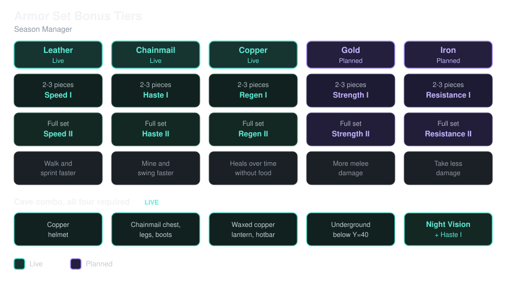

# Custom Manager

A Minecraft Bedrock Edition behavior pack for customizing and managing a
season of play, built on `@minecraft/server` and `@minecraft/server-ui`.

By [Gesh Giezel](https://github.com/iigeshii/season_manager_pack). Licensed
under the [MIT License](LICENSE).

## Layout

- `season_manager/season_pack/` — the behavior pack
  (`manifest.json`, `scripts/main.js`, `functions/`, `trading/`,
  `recipes/`, `loot_tables/`, `entities/`, `items/`, `blocks/`)
- `season_manager/season_resource_pack/` — the paired resource pack
  (`manifest.json`, `textures/`, `models/`, `attachables/`, `texts/`) —
  required for any custom item/block added from v2.0.0 onward to render
  at all (see [Two-pack structure](#two-pack-structure) below)
- `scripts/build.sh` — packages both packs into one `.mcaddon`
- `dist/` — build output; the `.mcaddon` files get committed for
  release, everything else in here is git-ignored
- `docs/` — standalone reference images (e.g. `armor_bonus_tiers.svg`,
  linked from this README and the release notes)
- `structures/` — `.mcstructure` files placed in the realm (the Mending
  Rescue dungeon and its Overworld portal) and the importer `.mcpack`s
  used to get them onto the realm, with where and how each was placed
  in [structures/README.md](structures/README.md)
- `tps/` — third-party source material kept for license verification
  (e.g. the Armed and Varied mod jar); see `CREDITS.md`
- `CREDITS.md` — third-party asset attribution, also embedded inside the
  built resource pack itself so it ships with the `.mcaddon`

## Two-pack structure

Starting at v2.0.0, custom items and blocks (the New Haven Rose Gold and
Bubblepearl content — see below) need both a behavior pack entry *and* a
matching resource pack entry (texture, model/attachable, lang name) to
work at all; a BP-only addition loads without errors but renders
invisible or with a missing-texture purple/black checker. The two packs
declare a two-way `dependencies` entry on each other's UUID in
`manifest.json`, so activating either one in a world turns on both, and
removing one prompts removal of the other.

## Building

```sh
./scripts/build.sh
```

Produces `dist/season_manager-<version>.mcaddon` (e.g.
`dist/season_manager-2.0.34.mcaddon`) — a renamed `.zip` with both pack
folders at its root, so one import installs both packs at once.
Versioned so each build gets its own file instead of overwriting the
last one. Double-click it (with Minecraft installed) or copy it into
your `development_behavior_packs`/`development_resource_packs` folders
to install.

Every build stamps the patch digit of every `"version"` array across
both manifests (and both module entries) with the number of commits
since the last major.minor bump — not the repo's lifetime commit count,
so a fresh bump like 1.x → 2.0 starts its first build at `.0` instead of
jumping straight to wherever the commit count happens to be. The
tracked source keeps the patch digit at `0` as a placeholder. Minecraft
only replaces an already-imported pack if the new one has a higher
version, so without this a rebuilt `.mcaddon` can silently get ignored
on reimport. This means the version only advances when you actually
commit — if you're testing uncommitted changes, the build is tagged
`-dirty` and the reimport won't be seen as an update over a clean build
of the same commit.

## Usage

Short list of every command: [COMMANDS.md](COMMANDS.md).

### Cleanup sequence

The pack automatically sweeps every online player every
`CLEANUP_INTERVAL_TICKS` (default 20 ticks = 1 second) and clears each item
in the `CLEANUP_ITEMS` list in
[`main.js`](season_manager/season_pack/scripts/main.js) — currently every
banned item except the diamond tools/weapon/armor set and Honey Block
(see below): `elytra`, `dispenser`, `dropper`, `sticky_piston`, `piston`,
`conduit`, `hopper`, `hopper_minecart`, `crafter`, `observer`,
`blaze_powder`, `enchanting_table`, `comparator`, `repeater`, and `daylight_detector`.
Elytra is here because it can turn up as loot (End ships) with no
crafting step involved, so a recipe lock wouldn't apply to it anyway —
it has no vanilla recipe at all.

Dispenser, Dropper, Sticky Piston, and Piston went further than the rest
of the list: all four originally had recipe locks (matching the technique
used everywhere else in this pack — see git history), but dropper, sticky
piston, and piston stopped showing up in the survival recipe book for
reasons that were never fully root-caused. Dispenser's lock was working
fine on its own; removing it as a diagnostic test brought Dispenser back
in the recipe book immediately, but dropper still didn't reappear, which
ruled out the leading theory (that dropper and dispenser were colliding
with each other over their near-identical vanilla shape) — and
piston/sticky piston aren't shape-twins with anything else in this pack,
so that theory didn't fit them either. Rather than ship four recipe files
with an unexplained, unreliable display quirk, all four were simplified
down to destroy-on-pickup only — their recipe lock files have been
removed entirely, so this is now the sole mechanism restricting them.
Repeater, added later after one turned up in the world, never had a
recipe lock at all for the same reason — it's destroy-on-pickup only
from the start.

Everything else on the list (conduit, hopper, hopper_minecart, crafter,
observer, blaze_powder, enchanting_table, comparator, daylight_detector)
still keeps its recipe lock too — this is belt-and-suspenders, not a
replacement for it. The reason it got added: a player found a loose
hopper in a trial chambers loot room, proving a recipe lock alone doesn't
stop something found rather than crafted, and there was no reason to
assume hopper was the only banned item with a real find-it-in-the-world
path.

The tradeoff versus a working recipe lock alone: a found/looted copy of
anything on this list doesn't survive either, where a pure recipe lock
(like the ten diamond items, which are deliberately excluded from this
list) leaves found/looted copies alone. If a milestone reopens one of
these items later, remember it needs removing from both places —
deleting its recipe lock file only stops crafting; it'll still get
destroyed on pickup until it's also taken out of `CLEANUP_ITEMS`. Anvil
(plus `chipped_anvil`/`damaged_anvil`) is the first real example of this
— though via a direct group vote (specifically to allow nametags) rather
than The Forge Reopens milestone, which hasn't actually been reached. All
three were removed from `CLEANUP_ITEMS` and `anvil.json` was deleted —
both halves had to change either way.
`heart_of_the_sea` is deliberately not on this list at all: it's inert on
its own, and the only thing it's good for (a Conduit) is already covered
by `conduit` being on the list, so restricting the raw item too would add
nothing.
When an item is actually removed from a
player, that player gets a chat message telling them it's currently
disabled. No command block or redstone clock needed; it starts as soon as
the pack loads.

To ban more items, add their item IDs to the `CLEANUP_ITEMS` array. To
change how often the sweep runs, adjust `CLEANUP_INTERVAL_TICKS`.

For manual testing you can also trigger a single sweep on demand from a
command block (no leading slash needed inside a command block):

```
scriptevent season:cleanup
```

or from chat/a command block via the bundled function:

```
/function season/cleanup
```

This requires cheats to be enabled in the world settings.

### Banned mobs

Any mob in the `BANNED_MOBS` set in
[`main.js`](season_manager/season_pack/scripts/main.js) — currently
`minecraft:iron_golem`, `minecraft:piglin`, `minecraft:piglin_brute`,
and `minecraft:zombie_pigman` (zombified piglins, which lit Nether portals
in the Overworld spawn on their own) — is removed the instant it spawns, whether it
appears naturally, gets built (e.g. pumpkin + iron blocks), or is
converted (e.g. a zombified piglin reverting in the Overworld). It's
despawned outright rather than killed, so no death event fires and it
drops no loot.

The piglin ban is a standing rule, not month-gated, so it's already in
effect even though piglins can't reach the Overworld until the Nether
opens (Month 5). It's still in effect afterward too — including during
Month 6's Bastion Remnant push, so bastions will be effectively
undefended until this is revisited.

Piglins and brutes the dungeon spawns itself (tagged `season:dungeon_mob`,
see [Nether rules](#nether-rules)) are exempt.

To ban more mobs, add their type IDs to the `BANNED_MOBS` set.

### Villager trades

All 13 villager professions have their trades disabled entirely. Trade
tables in
[`trading/economy_trades/`](season_manager/season_pack/trading/economy_trades/)
override the vanilla files at those same paths — same filenames, same
location — with `{"tiers": []}`, so no trades ever populate regardless
of profession or level: `armorer_trades.json`, `butcher_trades.json`,
`cartographer_trades.json`, `cleric_trades.json`, `farmer_trades.json`,
`fisherman_trades.json`, `fletcher_trades.json`,
`leather_worker_trades.json`, `librarian_trades.json`,
`shepherd_trades.json`, `stone_mason_trades.json`,
`tool_smith_trades.json`, and `weapon_smith_trades.json`.

This doesn't affect the [Rescue Villagers](#rescue-villagers) below —
their tables (`mending_librarian_trades.json`,
`froglight_cleric_trades.json`) are separate files, referenced only by
the custom rescue component groups, not by any vanilla profession name.

This is data, not script — none of it is gated by `enabled` or affected
by `scriptevent season:toggle`. To restore trading for a profession,
look up that file's git history for the unmodified vanilla version
committed just before it was emptied.

**Don't restore these straight from vanilla.** Some professions come
back with planned changes:

- `cleric_trades.json` — the rotten flesh trade sells at twice the
  vanilla rate: change its `wants` quantity from `32` to `16`
  `minecraft:rotten_flesh` for 1 emerald.
- `cartographer_trades.json` — village maps only at first. Leave out the
  Woodland Mansion, Trial Chamber, Ocean Monument, Jungle Temple and Swamp
  Hut explorer maps.
- `farmer_trades.json` — keep the Golden Carrot and Glistering Melon
  Slice trades (the "farmer specials").
- `armorer_trades.json`, `tool_smith_trades.json`,
  `weapon_smith_trades.json` — no diamond gear sales.

### Wandering Trader trades

Unlike the villager professions above, the Wandering Trader isn't fully
disabled — [`wandering_trader_trades.json`](season_manager/season_pack/trading/economy_trades/wandering_trader_trades.json)
replaces the vanilla trade list with a light-block, mob-head, banner
pattern and pottery sherd one, plus one always-available staple trade,
grouped into seven buckets:

- **Always available** — 1 Diamond for 4 Emeralds, a way to convert
  Diamonds into Emeralds rather than the other way around. This is its
  own `groups` entry with `num_to_select: 1` out of a single trade, so
  it's always picked — a bare `trades` array placed directly on the
  tier (alongside `groups`, the way vanilla's own simplest examples show
  it used alone) turned out not to render at all once a `groups` array
  was also present, so this uses the same group mechanism as everything
  else instead (`max_uses: 4`, same no-restock rule as the rest).

- **Common** (picks 5 of 13, no candles) — the 5 basic light blocks
  (Torch 16 @ 1 Emerald, Soul Torch 8 @ 1, Glowstone 8 @ 1, Redstone
  Lamp 4 @ 1, Jack o'Lantern 4 @ 1) plus all 8 Copper Lantern
  oxidation/wax variants (6 each @ 2 Emeralds).
- **Candles** (picks 1 of 17, own group) — any candle color including
  plain, 8 each @ 1 Emerald. This used to be merged into the Common pool
  above (picks 6 of 30), but with candles being over half the pool they
  crowded out everything else almost every time — a separate 1-pick
  group guarantees exactly one candle slot without letting them
  dominate the rest.
- **Uncommon/Rare** (picks 3 of 8, one merged pool) — Lantern, Soul
  Lantern, Sea Lantern, Shroomlight (6 each @ 2 Emeralds), and
  Ochre/Verdant/Pearlescent Froglight plus End Rod (4 each @ 3
  Emeralds).
- **Mob heads** (picks 1 of 4) — Skeleton Skull or Zombie Head (10
  Emeralds each), Creeper Head (12), or Player Head (16, and about half
  as likely as the other three). `max_uses: 1` — each head only ever
  sells once per trader, no repeat purchases. This version of Bedrock
  uses separate item identifiers per head
  (`minecraft:skeleton_skull`/`zombie_head`/`creeper_head`/`player_head`),
  not the older `minecraft:skull` + data-value system, confirmed against
  Mojang's current item metadata. The economy trade table format has no
  real per-trade `weight` field (despite some docs suggesting
  otherwise — vanilla's own trade tables never use one), so the Player
  Head's lower odds come from entry duplication instead: Skeleton Skull,
  Zombie Head, and Creeper Head each appear twice in the group and
  Player Head appears once, so out of the group's 7 total entries
  Player Head is picked 1/7 of the time versus 2/7 for each of the
  others — exactly half as often. Wither Skeleton Skull, Dragon Head,
  and Piglin Head are deliberately not offered (Wither Skeleton Skull
  specifically because 3 of them let you summon the Wither early).
- **Banner patterns** (picks 1 of 10) — all 10 loom patterns, `max_uses:
  1`: Flower Charge, Field Masoned and Bordure Indented (8 Emeralds),
  Creeper Charge, Skull Charge, Globe and Snout (`piglin_banner_pattern`)
  (12), and Thing (`mojang_banner_pattern`), Guster and Flow (16). Priced
  like the mob heads rather than the consumable trades, since a pattern
  is never used up in the loom and can be passed around — one purchase
  covers the whole server for good, so it should be a real buy. This
  includes patterns whose normal sources are still locked here — Skull
  Charge and Snout behind the Nether, Globe behind the cartographer's
  trades, Guster and Flow behind Trial Chamber vaults — on purpose:
  they're decoration only, so gating them just adds friction. Patterns
  aren't consumed by the loom, so one purchase is all anyone needs.
- **Pottery sherds** (picks 1 of 23) — all 23 sherds, 1 Emerald each,
  `max_uses: 4` — enough of the trader's one sherd to cover all four
  faces of a Decorated Pot, since sherds are used up when you craft one.
  Kept cheap because rarity already does the work: any one sherd only
  shows up on about 1 trader in 23, so finding a specific one stays a
  lucky find rather than a shop purchase. Kept in their own group
  rather than merged into Uncommon/Rare, where 23 sherds would have
  crowded out the 8 lights the same way candles once crowded out the
  Common pool.

Every banner pattern and sherd ID was checked against
[Mojang's item ID list](https://github.com/Mojang/bedrock-samples/blob/main/metadata/vanilladata_modules/mojang-items.json)
before being added — these 10 patterns and 23 sherds are the complete
sets on current Bedrock.

Price climbs with rarity (1/2/3 Emeralds) rather than staying flat,
matching vanilla's own convention of charging more for the less common
stuff — but each trade still hands back a generous stack rather than a
single unit, so it feels worth the cost rather than just pricier for the
same amount. `price_multiplier: 0.05` matches the other custom trade
tables' convention.

One gotcha worth flagging: Jack o'Lantern's real Bedrock item ID is
`minecraft:lit_pumpkin`, not `minecraft:jack_o_lantern` (Bedrock kept the
legacy name even after Java renamed it). A single invalid item ID
anywhere in this file silently invalidated every trade in it — the
trader would show up with an empty trade list and no error in the
content log — so if trades ever go missing again after an edit here,
check every `item` string against
[Mojang's block ID list](https://github.com/Mojang/bedrock-samples/blob/main/metadata/vanilladata_modules/mojang-blocks.json)
first.
Groups use `num_to_select` to pick a random subset of each category per
spawn, so no two Wandering Traders offer the exact same lineup, matching
vanilla's own randomized-offer behavior. Each trade is
capped at `max_uses: 3` and the Wandering Trader has no restock
mechanic in vanilla, so once a trade's uses run out for that spawn,
it's gone for good — same "wanders in, wanders out" lifecycle as
vanilla otherwise (still despawns after a few minutes, still spawns
llamas, etc. — nothing else about the entity was touched).

### Fishing

Fishing is fully vanilla now — no override file. Bow, Fishing Rod, and
Book treasure catches can all come pre-enchanted again (`enchant_with_levels`,
30 levels, treasure-only enchants), same as stock Minecraft. Earlier
versions of this pack stripped that function from Book catches only;
once it was restored, the override matched vanilla byte-for-byte and
was removed rather than kept as a no-op copy. See
`original_loot/loot_tables/gameplay/fishing/treasure.json` for
reference.

### Turtle scute drop

[`loot_tables/entities/sea_turtle.json`](season_manager/season_pack/loot_tables/entities/sea_turtle.json)
overrides the vanilla Turtle loot table (the entity is `minecraft:turtle`,
but vanilla names the loot table file `sea_turtle.json`) to add a 0-1
Turtle Scute drop on death, on top of the existing Seagrass drop. Vanilla doesn't drop Scute here at all — the only vanilla source is
a baby turtle growing into an adult, an entirely separate mechanic from
this loot table. See `original_loot/loot_tables/entities/sea_turtle.json`
for the unmodified vanilla version.

### Minecart speed

[`entities/minecart.json`](season_manager/season_pack/entities/minecart.json)
and
[`entities/chest_minecart.json`](season_manager/season_pack/entities/chest_minecart.json)
override the vanilla Minecart and Minecart with Chest to raise their rail
speed cap from 8 to 20 blocks per second. The only change is
`minecraft:rail_movement`'s `max_speed`, set to `1.0` blocks per tick
(vanilla leaves the component empty, which defaults to `0.4`). Powered
rails are still what accelerate a cart toward the cap, so lines need
enough of them to actually reach 20. Fast carts are more likely to
overshoot corners and slopes, so test a line with turns after any change.
The TNT and command block minecarts stay vanilla, and the hopper minecart
is a locked recipe. See `original_loot/entities/minecart.json` and
`chest_minecart.json` for the unmodified vanilla versions.

### Locked recipes

Recipes in [`recipes/`](season_manager/season_pack/recipes/) override
the vanilla recipe with the same `identifier` (recipes are matched by
identifier, not file path, but same idea as the trade table overrides:
highest-priority pack wins). Each locked recipe adds `minecraft:barrier`
as an extra required ingredient — a technical block with no way to
obtain it in survival — so the recipe still exists but can never actually
be crafted.

- **`blaze_powder.json`** — blaze rods can be found/used, but can't yet
  be ground into blaze powder. Also backed by `blaze_powder` in
  `CLEANUP_ITEMS` — see Cleanup sequence above.
- **`enchanting_table.json`** — diamonds, obsidian, and a book can all be
  gathered, but they can't yet be assembled into an enchanting table.
  Also backed by `enchanting_table` in `CLEANUP_ITEMS`.
- **`diamond_pickaxe.json`**, **`diamond_axe.json`**,
  **`diamond_shovel.json`**, **`diamond_hoe.json`**,
  **`diamond_sword.json`**, **`diamond_spear.json`**,
  **`diamond_helmet.json`**, **`diamond_chestplate.json`**,
  **`diamond_leggings.json`**, **`diamond_boots.json`** — all ten diamond
  tool/weapon/armor recipes are locked. Diamonds can be mined and held,
  they just can't be crafted into anything yet. Found/looted diamond gear
  (chest loot, mob drops) isn't affected — only crafting is blocked, since
  this is a recipe lock, not an item ban. Netherite Spear doesn't need its
  own lock, same as the other netherite upgrades — `smithing_netherite_spear`
  requires a Diamond Spear as its base ingredient, so it's already
  unreachable with the diamond recipe locked.
- **`conduit.json`** — Heart of the Sea is fully obtainable (buried
  treasure) and unrestricted on its own; it's inert without a Conduit, so
  this is the only lock that actually matters for it. Also backed by
  `conduit` in `CLEANUP_ITEMS`, so a found Conduit doesn't survive either.
- **`comparator.json`** — one of three vanilla crafting-table recipes
  (besides Quartz Block) that needs raw Nether Quartz. Also backed by
  `comparator` in `CLEANUP_ITEMS`.
- **`daylight_detector.json`**, **`daylight_detector_from_crimson_slab.json`**,
  **`daylight_detector_from_mangrove_slab.json`**,
  **`daylight_detector_from_warped_slab.json`** — vanilla actually ships
  four separate recipe identifiers for Daylight Detector (the base one
  plus a variant for each Nether wood slab), all needing raw quartz. All
  four are locked here — locking only the base one would leave the
  Nether-wood variants as an open bypass. The three wood-slab variants
  needed one more thing beyond the barrier: vanilla's own versions of
  these files have no `unlock` field at all, but Bedrock 1.20+ rejects
  any recipe missing one outright (visible as a `[Recipes][error] ...
  1.20+ Recipes require unlock data` line in the content log) — so
  mirroring vanilla exactly here actually breaks the override. Each one
  now has its own `"unlock": [{"item": "minecraft:quartz"}]`, same as
  the base recipe. Also backed by `daylight_detector` in `CLEANUP_ITEMS`.
- **`observer.json`** — the third quartz recipe. Also backed by
  `observer` in `CLEANUP_ITEMS`.
- **`hopper.json`**, **`hopper_minecart.json`** — a found hopper (chest
  loot in a few structures) could otherwise still be combined with a
  minecart, so the minecart recipe is locked too, not just the hopper's.
  Also backed by `hopper` and `hopper_minecart` in `CLEANUP_ITEMS` — this
  is exactly the found-hopper case that prompted adding the rest of this
  list to destroy-on-pickup in the first place.
- **`crafter.json`** — needs a Dropper as an ingredient, same as vanilla.
  Dropper itself is handled by destroy-on-pickup now (`dropper` in
  `CLEANUP_ITEMS`, see Cleanup sequence above) rather than a recipe lock —
  see that section for why — but a Dropper destroyed a tick after pickup
  could still theoretically get used in the same crafting action before
  cleanup runs, so this stays locked independently too, same reasoning as
  `hopper_minecart.json`. Also backed by `crafter` in `CLEANUP_ITEMS`
  itself, on top of that.

Anvil has no lock at all anymore — the group voted to allow it back
(specifically for nametags), not The Forge Reopens milestone, which
hasn't actually been reached. `anvil.json` was deleted and
`anvil`/`chipped_anvil`/`damaged_anvil` came off `CLEANUP_ITEMS` too. See
Cleanup sequence above.

Quartz Block itself, and anything crafted purely from a Quartz Block
(Quartz Pillar, Quartz Bricks, Chiseled Quartz Block, Quartz Stairs/Slabs,
Smooth Quartz and its stairs/slabs) are deliberately left alone — none of
those recipes need raw quartz as an ingredient, only the block, so once
the Nether's open and quartz ore is minable, all of that stays craftable.
Comparator, Daylight Detector, and Observer are the only three recipes
that need the raw item itself, which is why they're the ones locked.

Note on shape: crafting-table grids cap out at 3x3 — a shaped recipe
can't be wider or taller than that, full stop, so widening a pattern to
make room for the barrier only works if the vanilla recipe wasn't
already 3 wide. Most of these recipes had at least one empty cell in
their vanilla grid, so the barrier just fills that gap without changing
the recipe's footprint. `diamond_shovel.json` and `diamond_sword.json`
are vanilla single columns, so widening them to 2 columns for the
barrier is still well inside the 3x3 cap. `conduit.json`,
`daylight_detector.json` and its three wood-slab variants, and
`observer.json` are different: their vanilla grids are already a
completely full 3x3 (conduit's 8 nautilus shells around 1 heart of the
sea; daylight detector's 3 glass / 3 quartz / 3 slabs; observer's 6
cobblestone, 2 redstone, 1 quartz), so there's no room to add a 10th
cell. Those five instead have the barrier swap in for one of the
original filled cells (one nautilus shell or one glass) rather than sit
in new space — same effect, just one fewer of that particular vanilla
ingredient asked for, since the recipe can never be finished anyway.
`comparator.json`, `hopper.json`, and `diamond_spear.json` all had a
spare cell already in their vanilla 3x3 grid, so those three kept the
vanilla footprint. `crafter.json`'s vanilla grid is also a
completely full 3x3 (5 iron ingots, 1 crafting table, 2 redstone, 1
dropper), so it uses the same swap-in-a-filled-cell approach — one iron
ingot, in this case.
`hopper_minecart.json` is shapeless (like `blaze_powder.json`), so grid
size doesn't apply — the barrier is just a third required ingredient
alongside the hopper and minecart.

Same caveats as the trading overrides: this is data, not gated by
`enabled`/`scriptevent season:toggle`, and it freezes at whatever vanilla
recipe shape was copied in, so a future game update to this recipe won't
reach this pack until someone re-syncs it. One UX wrinkle: the recipe
book will still show it as unlocked once you hold a blaze rod (the
`unlock` condition is untouched), it just won't actually complete when
attempted — restore by deleting the file.

### Added recipes

Unlike everything in [Locked recipes](#locked-recipes) above, these
aren't overriding a vanilla identifier — they're new. A few vanilla
recipes only go one direction between two items, with no recipe for the
reverse; these fill that gap.

- **`rabbit_hide_from_leather.json`** — vanilla has 4 Rabbit Hide → 1
  Leather (`minecraft:leather`'s recipe) but nothing going back the other
  way. This is the exact mirror, just flipped: 1 Leather → 4 Rabbit Hide.
  Shapeless (no specific grid arrangement needed for a single
  ingredient), under its own `season:rabbit_hide_from_leather` identifier
  so it can't collide with any real or future vanilla recipe.
  Round-tripping through both recipes nets zero material gain or loss
  either direction, so this doesn't introduce a duplication exploit.
- **`melon_from_melon_block.json`** — same situation: vanilla has 9
  Melon (the slice item is actually called `minecraft:melon` in Bedrock)
  → 1 Melon Block (`minecraft:melon_block`'s recipe), but nothing going
  back. This is the mirror: 1 Melon Block → 9 Melon. Shapeless, under
  `season:melon_from_melon_block`. Same no-duplication-exploit reasoning
  as the Rabbit Hide recipe above — 9 slices in either direction, no net
  gain.
- **`chainmail_helmet.json`**, **`chainmail_chestplate.json`**,
  **`chainmail_leggings.json`**, **`chainmail_boots.json`** — Chainmail
  armor has no real crafting-table recipe in vanilla at all (only a
  furnace recipe for smelting a damaged piece back into a fresh one —
  see `original_loot/recipes/` for the vanilla iron armor recipes these
  were shaped after), so these are entirely new, under the real
  `minecraft:chainmail_*` identifiers since nothing else claims them.
  Same silhouette as the matching iron armor piece, but built from a mix
  of Chain (the frame — brow band, shoulder straps, waistband, ankle
  cuffs) and Iron Nugget (the mesh fill) instead of solid Iron Ingots:
  helmet 3 Chain + 2 Nugget, chestplate 2 Chain + 6 Nugget, leggings 3
  Chain + 4 Nugget, boots 2 Chain + 2 Nugget. Works out to roughly
  3.9/3.1/4.1/2.7 Iron Ingots' worth of material respectively (Chain
  itself costs 1 Ingot + 2 Nuggets to make, and 9 Nuggets = 1 Ingot) —
  cheaper than the matching iron piece across the board, which fits
  Chainmail's spot between Leather and Iron in vanilla's armor values.
- **`bell.json`** — Bells have no crafting recipe in vanilla (only found
  in villages or bought from Armorers, Toolsmiths and Weaponsmiths). This
  one is new, under `season:bell`, on a crafting table:

  ```
  Stone      Stick      Stone
  -          Gold Ingot -
  Gold Ingot Redstone   Gold Ingot
  ```

  2 Stone (plain `minecraft:stone`, not cobblestone), 1 Stick, 3 Gold
  Ingots and 1 Redstone Dust make 1 Bell. It shows in the recipe book
  once you hold a Gold Ingot.

### Swapped-ingredient recipes

Same vanilla `identifier`, same shape, same quantities — only the
material changed. Unlike [Locked recipes](#locked-recipes), these still
craft normally; nothing here is disabled.

- **`leather_helmet.json`**, **`leather_chestplate.json`**,
  **`leather_leggings.json`**, **`leather_boots.json`** — all four use
  Rabbit Hide (`minecraft:rabbit_hide`) instead of Leather now, in the
  exact same pattern and quantity vanilla used for Leather (3/6/7/4
  respectively — see each file's `pattern`). Plain Leather can still be
  worn if already owned, and still converts to/from Rabbit Hide via
  the vanilla recipe and `rabbit_hide_from_leather.json` above — it's
  just no longer what these four recipes ask for. `leather_horse_armor.json`
  was deliberately left alone; "leather armor" was read as the four
  player-wearable pieces, not horse armor.

### Rescue Villagers

Permanent, single-trade villagers that bypass the standing "all trades
disabled" rule above, summoned on demand via a bundled function. Each
one is a real `minecraft:villager_v2` whose profession is overridden in
[`entities/villager_v2.json`](season_manager/season_pack/entities/villager_v2.json)
with a custom component group carrying its own `economy_trade_table`
and `minecraft:dweller: {"can_find_poi": false}` (so it can't wander
off and reclaim a real job site, which would otherwise silently wipe
its trade). A script watchdog in
[`main.js`](season_manager/season_pack/scripts/main.js) re-fires the
becoming-event on a short interval as a backstop.

Each `summon_*.mcfunction` summons the entity, then targets it with
`@e[type=<type>,c=1]` for the `tag` and `/event entity` that follow.
Note for anyone touching this: Bedrock's `c=<n>` on `@e`/`@a`/`@p`
already sorts by increasing distance from the command's execution
position — there's no `sort=` keyword like Java Edition has, and adding
one is a hard parse error that fails the whole function to load. Since
the summon happens at the same position the function runs from, `c=1`
alone reliably resolves to the entity that was just created.

- **Mending Librarian** — `/function season/summon_mending_librarian`
  spawns a villager with exactly one trade: 20 emeralds for a book with
  Mending. Trade table:
  [`mending_librarian_trades.json`](season_manager/season_pack/trading/economy_trades/mending_librarian_trades.json).
- **Froglight Cleric** — `/function season/summon_froglight_cleric`
  spawns a villager offering all three froglight colors (ochre,
  verdant, pearlescent) for 5 emeralds each. Trade table:
  [`froglight_cleric_trades.json`](season_manager/season_pack/trading/economy_trades/froglight_cleric_trades.json).

Both functions require cheats to be enabled. Like the trade and recipe
overrides above, this is data plus a small always-on watchdog, not
gated by `enabled`/`scriptevent season:toggle`.

### Elite mobs

Standalone mini-bosses, summoned on demand, that stay permanently
tougher than their vanilla counterpart — same tag-and-event pattern as
the Rescue Villagers, just applied to a hostile mob instead of a
villager.

- **Elite Zombie** — `/function season/summon_elite_zombie` spawns 7
  blocks ahead of whichever way the caster is facing and 5 blocks above
  them (`^ ^5 ^7`, not `~ ~ ~`), so it doesn't land right on top of them
  and there's room for the Slow Falling drift described below. It's a
  hostile mob, so it won't stick around — or spawn at all — on Peaceful
  difficulty; that's vanilla behavior, not a pack bug. Vanilla Zombies
  randomly spawn as a baby (or baby jockey) about 5% of the time, so
  right after tagging it the function fires a new `season:force_adult`
  event — removes `minecraft:zombie_baby`/`minecraft:zombie_jockey` and
  re-adds the adult component groups, undoing that roll if it happened
  — before the elite stats get applied, guaranteeing a full-size Elite
  Zombie every time. The zombie itself has 200 health (vanilla: 20), 6
  attack damage (vanilla: 3), full
  knockback resistance, a permanent Strength II / Resistance I /
  Fire Resistance / Regeneration effect stack (re-applied every 5
  seconds by a watchdog in
  [`main.js`](season_manager/season_pack/scripts/main.js), with each
  application lasting 30 seconds — well past the 5-second recheck — so
  a server lag spike that delays the watchdog doesn't let the effects
  lapse before the next one fires, since potion effects expire on their
  own and the stat components don't), and a
  guaranteed enchanted iron sword plus a full iron armor set, trimmed
  bright red (Redstone material, Wayfinder pattern) on every piece so
  it's immediately recognizable as the boss instead of a regular
  iron-armored zombie — see
  [`entities/zombie.json`](season_manager/season_pack/entities/zombie.json),
  [`season_elite_zombie_equipment.json`](season_manager/season_pack/loot_tables/entities/season_elite_zombie_equipment.json),
  and
  [`season_elite_zombie_armor.json`](season_manager/season_pack/loot_tables/entities/season_elite_zombie_armor.json)
  (a copy of vanilla's `armor_set_iron.json` with a `set_armor_trim`
  function added to each piece — kept as its own file rather than
  overriding the shared vanilla one, so nothing else that might use
  `armor_set_iron.json` is affected). Vanilla's own version only gives
  the chestplate/leggings/boots a chance each (50% by default, gated
  behind each other, so a bad roll skipped the whole rest of the set) —
  the pack's copy drops the `random_difficulty_chance` conditions
  entirely, so the full trimmed set is guaranteed every time, not just
  the helmet.

It's still `minecraft:zombie` under the hood (not a new custom
identifier), specifically so it renders normally without needing a
resource pack override — the same rendering pitfall that sank the
abandoned biome-trader villager work on `feature/biome_trader`.

The same function also spawns a ring of 12 plain guard mobs around it —
6 Zombies and 6 Skeletons alternating every 30° around a 12-block-radius
circle, using `execute ... rotated <angle> 0` at each of the 12 compass
directions off the Elite Zombie's position. Both guard types get 40
health (vanilla: 20) via their component groups, tagged `season:elite_guard`,
each given an Iron Helmet so they don't burn to death standing out in
daylight during the event, plus a permanent Strength I (a modest damage
bump) and Speed I (noticeably faster than normal, but well short of a
baby zombie's speed) — applied once via `/effect ... 1000000 0 true` at
summon time rather than a watchdog, since the effects (unlike health)
aren't part of the entity's own component groups.

The guard Skeletons also fire arrows on a random 1-3 second interval,
about the same pace as vanilla but rolled fresh each shot instead of a
fixed 2-3 seconds. A Skeleton's fire rate is a base entity component, not
something a potion effect can touch, so this needed a full-copy
override — [`entities/skeleton.json`](season_manager/season_pack/entities/skeleton.json) —
with a new `season:elite_guard_skeleton` component group carrying a
faster `minecraft:behavior.ranged_attack`, added via a custom event
fired only on the tagged guard Skeletons after they spawn. This doesn't
affect any other Skeleton in the world — only ones tagged
`season:elite_guard`.

All the event's mobs — the Elite Zombie and both guard types — share a
`season_elite` type family and three coordinated tuning changes, applied
via `season:elite_zombie` (existing), a new `season:elite_guard_zombie`
group, and the extended `season:elite_guard_skeleton` group:

- **No friendly fire.** A `minecraft:damage_sensor` trigger zeroes out
  any damage from another `season_elite`-family mob, and
  `minecraft:behavior.hurt_by_target` is extended to never retaliate
  against one either. Without this, a guard Skeleton's arrow going wide
  and clipping a guard Zombie (or the Elite Zombie itself) used to start
  infighting.
- **Longer detection and chase range.** `minecraft:behavior.nearest_attackable_target`
  is narrowed to players only (guards don't care about villagers/iron
  golems/etc.) but its `max_dist` is raised to 48, and a
  `minecraft:follow_range` of 48 is added so a spotted player isn't
  dropped once they're chased — vanilla Zombies stop pursuing well
  before that (Skeletons don't set an explicit follow range at all,
  meaning they'd fall back to a much shorter engine default).
- **Skeletons shoot farther.** `attack_range` on the guard Skeleton's
  ranged attack goes from 15 to 32 blocks. They still fire vanilla's own
  `minecraft:arrow` — an earlier attempt at a custom `season:long_arrow`
  projectile with flatter/more-accurate flight was reverted because a
  new entity identifier with no matching resource pack model renders
  invisibly in-game (the same client-side pitfall noted below for the
  Elite Zombie's own identifier, and the reason it stayed
  `minecraft:zombie` instead of getting a custom one).

Both the Elite Zombie and its guards get a 30-second Slow Falling effect
the instant they spawn, so they drift gently down to actual solid ground
instead of taking fall damage (or dying) — this matters because the
function is meant to be run by someone flying above the battlefield in
Creative (e.g. a DM), which would otherwise spawn everything at the
caster's altitude, floating in mid-air. The guards' spawn offsets also
place them 1 block higher than the Elite Zombie's own position
(`^ ^1 ^12` instead of `^ ^ ^12`) to keep them from landing partially
embedded in small terrain bumps around it.

None of the event's mobs despawn on their own. Vanilla Zombies and
Skeletons can randomly despawn from chance, inactivity, or simulation
edge distance if no player is nearby for a while. The first attempt at
disabling this — setting `despawn_from_chance`/`despawn_from_inactivity`/
`despawn_from_simulation_edge` to `false` — actually made things *worse*:
mobs spawned and despawned almost instantly, meaning those flags don't
mean "never despawn from this rule" the way they read; they more likely
skip the randomized gate on the rule, so it fires unconditionally
instead of never. The working fix, on the Elite Zombie and both guard
groups, is a `minecraft:despawn` override with a `filters` block that
can never evaluate true (`is_family` against a family string, `season_never_despawns`,
that nothing is ever tagged with) — per Bedrock's own docs, defining
`filters` at all makes the standard despawn rules ignored entirely, so
only that (never-satisfied) filter decides, and the mobs are permanent
until killed. Same philosophy as the Rescue Villagers, just via a
different component since despawn works differently for hostile mobs
than for villagers.

Requires cheats to be enabled. Not gated by
`enabled`/`scriptevent season:toggle` — this is a standalone encounter,
not a season restriction.

#### Reinforcements and enrage

Group feedback on the original fight was that it was too easy with a
full squad, since it always spawned the same fixed 12 guards regardless
of how many players showed up, and its stats never changed over the
course of the fight. The fix deliberately keeps the *opening* fight at
a flat 12 no matter the group size — the original 12 already felt like
a lot to deal with at once — and puts all the scaling into what happens
after that, via two additions in
[`main.js`](season_manager/season_pack/scripts/main.js):

- **Reinforcement waves, every 45 seconds.** A still-alive Elite Zombie
  counts players within 50 blocks and spawns 2 guards per player,
  capped at **12 guards per wave** regardless of how many players are
  actually there. A lone player gets 2 per wave; a group gets a bigger
  wave, but never a bigger one than the opening 12 felt like.
- **Enrage at half health.** A watchdog checks each Elite Zombie's
  current health against its max every 5 seconds. The first time it
  drops to 50% or below, it permanently gains Strength III/Speed II (on
  top of its usual Strength II stack), announces itself in chat, and
  immediately triggers the *exact same* reinforcement-wave formula as
  above — then that wave's own timer reset means the next 45-second
  wave counts from the enrage moment, not from whenever the last
  scheduled wave happened to be, so the two don't stack back to back. A
  tag (`season:elite_zombie_enraged`) stops the buff/announcement from
  repeating, but reinforcement waves keep coming on their normal timer
  afterward.

Since the boss never despawns on its own, reinforcement waves aren't
allowed to keep coming forever — but the budget is a count of **waves**,
not a count of guards. Capping by guard count instead would mean a
solo or two-player fight (where each wave is small, since the formula
scales with player count) could rack up dozens of separate wave events
before hitting the same ceiling a full group reaches in a handful — a
lot of repeated interruptions even with a perfectly reasonable total
mob count. Every Elite Zombie instead carries a dynamic property
tracking how many waves have fired in the *current phase*, capped at
**5 waves** regardless of group size (a wave with nobody nearby to
scale for doesn't consume one — it just doesn't fire). If the
pre-enrage phase runs long enough to use up all 5 on its own — a group
really struggling to bring the boss down — reinforcements simply stop
coming until enrage actually happens. At that point the counter resets
to 0, buying a completely fresh 5 waves for the enraged half of the
fight. The enrage buff and chat announcement always happen regardless
of budget; only the extra guards are ever affected by it.

Every wave announces itself in chat — "The Elite Zombie calls for
reinforcements..." followed by "Reinforcements arrive — the Elite
Zombie's escort grows by N." When no players are within 50 blocks,
nobody is fighting, so the call stays silent and doesn't spend a wave.
The wave that uses up a phase's budget also says so ("the
last wave until the Elite Zombie is enraged", or "no more reinforcements
are coming" once it's already enraged); after that the timer stays quiet
instead of repeating the line every 45 seconds. The 45-second timer is
stored on the boss as a game tick, and `system.currentTick` restarts at
0 each server session, so the watchdog resets a stored tick that's
ahead of the current one — otherwise a boss that outlived a restart
would go quiet until the new session's tick count caught up. This matters
for the same reason the
[Farm animal population cap](#farm-animal-population-cap) below exists:
an encounter that's permanent and can keep spawning mobs needs its own
bound on Bedrock's 200-mob world budget, same as an unattended farm
does.

Every reinforcement wave spawns guards through the same
`spawnEliteGuard`/`spawnEliteGuardRing` helpers the base 12 effectively
use too, so they get identical tagging, armor, effects, and despawn
protection — nothing about them is a lesser copy of the original ring.
They also spawn 8 blocks above the boss's current position and rely on
their own Slow Falling to bring them down
(`ELITE_GUARD_SPAWN_HEIGHT_OFFSET_BLOCKS`), so hilly or uneven ground
near the fight can't land one partially embedded in a slope — same
reasoning as the boss's own `^5` elevated spawn offset above.



### Leather armor speed bonus

Leather armor is crafted from Rabbit Hide now (see
[Swapped-ingredient recipes](#swapped-ingredient-recipes) above), and
wearing it grants a speed buff to match: 2 or 3 pieces of leather armor
worn grants Speed I, and a full 4-piece set grants Speed II instead (not
stacked on top of Speed I — it's one or the other). Checked and
re-applied every 5 seconds by a watchdog in
[`main.js`](season_manager/season_pack/scripts/main.js)
(`LEATHER_ARMOR_SLOTS`), since potion effects expire on their own and
armor doesn't trigger a re-check by itself. Each application lasts 30
seconds, not just a hair over the 5-second recheck — a real incident
where a laggy mob farm slowed the server enough to delay the watchdog
past the old, tighter margin caused the Speed buff to drop out early
mid-fight, so the duration was widened well past anything a lag spike
should plausibly cause. Mixing leather with other
armor materials still counts each leather piece — a leather helmet with
three diamond pieces is 1 leather piece worn (no buff), not disqualified
from the count entirely.

Like Elite Mobs, this isn't gated by `enabled`/`scriptevent
season:toggle` — it's a standing mechanic, not a season restriction.

### Chainmail armor haste bonus

Same idea as the Leather Armor Speed Bonus above, just Chainmail and
Haste instead of Leather and Speed: 2 or 3 pieces of Chainmail armor
worn grants Haste I, and a full 4-piece set grants Haste II instead (not
stacked on top of Haste I). Same watchdog pattern too — checked and
re-applied every 5 seconds, each application lasting 30 seconds for the
same lag-spike margin as the Leather bonus above
(`CHAINMAIL_ARMOR_SLOTS` in
[`main.js`](season_manager/season_pack/scripts/main.js)), and mixing
Chainmail with other armor materials still counts each Chainmail piece
individually toward the total.

Not gated by `enabled`/`scriptevent season:toggle`, same as the Leather
bonus.

### Copper armor regeneration bonus

Same two-tier watchdog shape as Leather/Chainmail above: 2 or 3 pieces
of Copper armor worn grants Regeneration I, and a full 4-piece set
grants Regeneration II instead (not stacked on top of Regeneration I)
(`COPPER_ARMOR_SLOTS` in [`main.js`](season_manager/season_pack/scripts/main.js)).
Copper armor has low defense on its own, so the healing bonus is meant
to be its real value — a full set competes with a maxed-out Beacon's
Regeneration II (which costs a Nether Star and a full 4-layer pyramid,
and only works in a fixed radius) by being cheap, portable, and
permanent the moment it's worn instead.

Regeneration needed one extra consideration the Speed/Haste bonuses
didn't: its actual healing tick is paced by amplifier (every 50 ticks
at Regeneration I, every 25 at Regeneration II), and that cycle restarts
from 0 every time a fresh instance of the effect is applied. Re-applying
on too tight a loop — every single tick, for example — would restart
the cycle before it ever reached tick 25/50, and the player would never
actually heal. This re-applies every 100 ticks (5 seconds), the same
cadence already used for Speed/Haste, which is coarser than either heal
cycle, so each 5-second window comfortably contains at least one heal
before the next refresh restarts it. The 30-second duration on each
application is still just the same lag-spike margin as the other
bonuses, not a requirement for healing to work.

### Iron armor resistance bonus

Same two-tier watchdog shape as Leather/Chainmail/Copper above: 2 or 3
pieces of Iron armor worn grants Resistance I, and a full 4-piece set
grants Resistance II instead (not stacked on top of Resistance I)
(`IRON_ARMOR_SLOTS` in [`main.js`](season_manager/season_pack/scripts/main.js)).
Rounds out the armor-bonus grid shown in
[`docs/armor_bonus_tiers.svg`](docs/armor_bonus_tiers.svg) — Iron was
the last vanilla-material gap between Chainmail and Diamond.

### Rose Gold armor strength bonus

Same shape again, this time for New Haven's custom Rose Gold armor (see
[Rose Gold gear](#rose-gold-gear) below): 2 or 3 pieces worn grants
Strength I, a full 4-piece set grants Strength II instead
(`ROSE_GOLD_ARMOR_SLOTS` in
[`main.js`](season_manager/season_pack/scripts/main.js), keyed off the
`newhaven:rose_gold_*` armor identifiers). Rose Gold's own stats already
sit between Iron and Diamond (see below), so Strength is its reward for
actually reaching that tier rather than its only selling point.

### Cave combo: Night Vision

A fifth bonus, layered across materials rather than tied to one: wear a
Copper Helmet, a full Chainmail body (Chestplate + Leggings + Boots),
carry a waxed Copper Lantern anywhere in the hotbar (any of the 4
oxidation stages — `minecraft:waxed_copper_lantern`,
`waxed_exposed_copper_lantern`, `waxed_weathered_copper_lantern`,
`waxed_oxidized_copper_lantern`; an unwaxed lantern doesn't count), and
be below Y=40 (`CAVE_COMBO_MAX_Y` in
[`main.js`](season_manager/season_pack/scripts/main.js) — a single
line to retune), and you get Night Vision on top of everything else.

This doesn't change anything about the individual bonuses above: the 3
Chainmail pieces still grant Haste I on their own exactly as before (2-3
pieces = Haste I), and a lone Copper Helmet is below Copper's own
2-piece threshold, so it grants nothing by itself — the combo only adds
Night Vision once every condition lines up at once.

Each application is a 30-second duration, refreshed every 5 seconds —
comfortably over the 15-second floor Night Vision needs, since its
screen effect starts fading/flickering under about 10 seconds
remaining. When a condition stops being met (armor swapped, lantern
dropped, player climbs back above Y=40), this simply stops
re-applying and lets the existing Night Vision run out naturally rather
than clearing it outright — clearing it would also strip Night Vision
from an actual potion the player drank independently of the combo.

Not gated by `enabled`/`scriptevent season:toggle`, same as the other
armor bonuses.

### Farm animal population cap

Bedrock's global mob cap is a flat 200 mobs world-wide — once that's
hit, natural spawning of *everything* (zombies, skeletons, new
wildlife) stops dead, everywhere, until the count drops back down. An
unattended breeding pen is the usual culprit: Pigs, Chickens, Cows, and
Sheep breed exponentially if fed and never thinned out, and it's easy
for one farm to quietly eat most of that budget on its own.

A watchdog in [`main.js`](season_manager/season_pack/scripts/main.js)
(`FARM_ANIMAL_TYPES`/`FARM_ANIMAL_CAP`) checks the combined Overworld
population of Pigs, Chickens, Cows, and Sheep every 5 seconds, and if
the total is over 160, despawns surplus animals one at a time until it's
back at 160 or under. This is a world-wide total, not per-area — `getEntities`
with no location filter returns every matching entity in every currently
loaded chunk in the dimension, so two unrelated farms on opposite sides
of the map both count against the same combined cap as long as both are
loaded. It despawns rather than kills (`.remove()`, not
`.kill()`) specifically so this can't be exploited as a free meat/wool
farm — no death event, no loot drop, no XP. Whenever a cull happens,
every player gets a short chat message, one line per species culled
(`§e3 pigs despawned (mob cap).`, `§e1 sheep despawned (mob cap).`).

Each despawn comes from whichever of the 4 species currently has the
most individuals loaded, recalculated after every single removal — it's
not a flat random pick across all four species combined. This matters
for lopsided farms: 200 Sheep and 2 Cows only ever costs Sheep, since
Cows never become the largest group (ending at 158 Sheep + 2 Cows once
the combined total is back at 160). A flat random pick across the whole
pool would instead cull roughly proportionally and could easily wipe
out the 2 Cows on bad luck alone. If every species is already even,
this naturally converges toward keeping them even — e.g. 40 of each at
a 160 cap.

Within whichever species gets picked, babies are an absolute priority —
every baby of that species despawns before a single adult of it is
touched. A weighted preference (babies just more *likely* than adults)
wasn't enough in practice: babies are usually a small slice of a
species' population at any moment, since they grow up in about 20
minutes, so most culls still landed on adults purely because there were
so many more of them. Once no babies of that species are left, adult
selection is weighted rather than absolute for the one Sheep-specific
case: white/undyed Sheep are 3x more likely to be picked than colored
ones, but colored Sheep still have a real chance too. An earlier version
made that Sheep preference absolute (exhaust every undyed Sheep before
touching a colored one) and it wiped out every white Sheep in the world
in one pass, since most naturally-spawned Sheep are undyed to begin
with — weighting avoids repeating that, while babies stay a hard rule
since there isn't the same "wipe out a whole species" risk with them
(they regrow within minutes regardless).

Named animals (given a Name Tag) are absolutely protected — never a
cull candidate, full stop, no matter the species, species count, or
anything else. They still count toward the 160 total, since they're
still real entities on Bedrock's mob budget, but "largest species" and
all target selection only ever look at unnamed animals, so a named
individual can literally never be the one despawned. If every animal
left over the cap happens to be named, the watchdog just does nothing
that pass rather than touch a protected one — the cap can stay exceeded
in that case, which is the intended trade-off. Not gated by
`enabled`/`scriptevent season:toggle`, same as the other standalone
watchdogs in this pack.

### Cheaper trim template duplication

All 19 Armor Trim Smithing Template duplication recipes (see
`original_loot/recipes/` for the vanilla originals this replaced) are
overridden to drop their cost from 7 Diamonds down to a single Copper
Ingot. Everything else about each recipe stays the same: same template,
same pattern-specific base material (e.g. Dune still needs Sandstone,
Coast still needs Cobblestone), same 2-copies result. Vanilla's version
of each recipe is shaped (a specific 3x3 arrangement); these are
shapeless instead, since there's no reason to force a particular grid
position once it's down to three distinct ingredients with no
duplicates. Bolt's separate waxed-copper variant is included too. The
Netherite Upgrade Smithing Template's duplication recipe is untouched —
it's a different template, not an armor trim, and wasn't part of this
change.

### Portal lock

Nether portals and the End portal are blocked from being activated:
using flint and steel, a lava bucket, or a fire charge on obsidian, or
an eye of ender on an end portal frame, does nothing and tells the
player it's currently disabled. Configured via the `PORTAL_IGNITERS`
list in [`main.js`](season_manager/season_pack/scripts/main.js). The
lava bucket case matters because pouring lava directly into a completed
obsidian frame ignites it too, same as flint and steel — a
Bedrock-specific mechanic Java doesn't have, easy to miss if you're only
picturing flint and steel.

Operators (players tagged `season:operator`, see
[Nether rules](#nether-rules)) may light Nether portals, to run the
dungeon event. While the [Nether portal switch](#nether-portal-switch)
is on, or a [Mending Rescue](#mending-rescue-event) run is on that
latecomers can still join, anyone may light a Nether portal. End portals stay locked for
everyone. The lock isn't paused by `scriptevent season:toggle`.

This only intercepts a *player* actually using the item — it hooks
`itemUseOn`, which never fires for a dispenser or hopper clock
triggering the same item with no player involved. An automated ignition
setup (e.g. a dispenser-fed lava bucket or fire charge on a timer) will
still light the portal; nothing currently catches that, since there's
no ignition-side event to intercept and no reliable way to detect "a
portal just turned on" from script. Closing that gap would mean
periodically scanning for lit portals and breaking the obsidian frame
outright (not just the portal's air blocks, which self-heal from an
intact frame) — deliberately not implemented yet, since it would be the
first thing in this pack that destroys player-placed blocks
automatically.

This also only stops *ignition* — a ruined portal or bastion remnant
that already generates lit is unaffected, since there's no ignition
action to intercept. See dimension bounce-back below for the fallback
that covers that case (though note dimension bounce-back only helps
once a player actually travels through — a farm that never sends a
player into the Nether isn't touched by it either).

### Dimension bounce-back

Any player who ends up in a dimension listed in `DISABLED_DIMENSIONS` in
[`main.js`](season_manager/season_pack/scripts/main.js) — currently the
Nether and The End — is immediately teleported back to exactly where they
left from, with a chat message telling them they entered a forbidden
dimension. This is the fallback for anything the portal lock doesn't catch
(pre-lit ruined portals, bastion remnants, or any other way in), since it
reacts to the dimension change itself rather than the portal that caused
it.

Operators (players tagged `season:operator`) are not bounced from the
Nether, nobody is while the [Nether portal switch](#nether-portal-switch)
is on, and a sealed [Mending Rescue](#mending-rescue-event) party isn't
either. During a run, anyone else coming into the Nether joins the party
at its checkpoint instead of being bounced, until the Room 8 scene starts.
The End stays sealed for everyone. The bounce-back isn't paused
by `scriptevent season:toggle`.

The portal itself is left standing — an earlier version tried to destroy
it after the fact, but nether/end portals resist being torn down
piecemeal via script (nether portals in particular re-validate their own
shape and silently refill anything removed from an intact frame), so a
player standing right next to it can just walk back in immediately. A
flat "bounces twice, send to spawn" backstop turned out not to be
reliable in practice — players could get stuck cycling in and out faster
than it caught. Instead, each consecutive bounce (tracked per-player in
`bounceCounts`, within `BOUNCE_COOLDOWN_TICKS` of the last one) nudges the
return point that many extra blocks away — 2nd bounce lands 2 blocks off,
3rd lands 3, and so on — so someone standing right on the portal frame
keeps landing further clear of it each time instead of walking straight
back onto it. `BOUNCE_GIVE_UP_COUNT` (10) is a hard cap: if nudging still
somehow hasn't cleared the portal after 10 tries, the player is sent to
world spawn instead — dropped onto the ground nearest spawn's X/Z rather
than its raw Y, since a world spawn point that was never explicitly set
can report a nonsensical height.

To ban/unban a dimension, add or remove its ID in `DISABLED_DIMENSIONS`.

### Nether rules

The Nether exists only for the Mending Librarian Rescue dungeon. Code in
[`scripts/dungeon/nether_rules.js`](season_manager/season_pack/scripts/dungeon/nether_rules.js).

**Operators.** Operator status comes from a tag for now
(`Player.playerPermissionLevel` needs `@minecraft/server` 2.1.0; this
pack is on 1.14.0). Tag yourself once:

```
/tag @s add season:operator
```

Operators may light Nether portals and enter the Nether (see
[Portal lock](#portal-lock) and
[Dimension bounce-back](#dimension-bounce-back)). Everyone else gets in
in only while the [Nether portal switch](#nether-portal-switch) is on.

**Game mode.** Operators keep whatever mode they're in. Everyone else is
put in adventure while in the Nether and survival everywhere else — no
creative or spectator. Applied on dimension change, on login/respawn,
and by a sweep every second. In the Nether, non-operators can't break
any block either, which covers the moment after arriving before
adventure is applied. There's no exception for Gravestone add-on graves
any more: runs have keep inventory on (see **Keep inventory** under
[Mending Rescue event](#mending-rescue-event)), so no graves are made in
the dungeon, and the old survival window by a grave let tools that break
extra blocks damage the building. A grave left in the Nether some other
way has to be broken by an operator.

**No beds or TNT.** Nobody, operators included, can place a bed (any
colour), TNT or a TNT minecart in the dungeon or within 8 blocks of it
(the structure's box from its origin and size in `layout.js`, plus 8 on
every side). The placement is cancelled with "Beds and TNT can't be placed
in the dungeon." Nothing happens until the dungeon's origin is set. Code
in [`scripts/dungeon/no_explosives.js`](season_manager/season_pack/scripts/dungeon/no_explosives.js).

**Mobs.** The only mobs allowed in the Nether are ones the pack spawns,
which are tagged `season:dungeon_mob` (via `spawnDungeonMob()`). Any
other mob — vanilla or from any add-on — is removed outright (no death
event, no drops, no XP) when it spawns, when it loads with a chunk, and
by a sweep every 3 seconds. "Mob" means the entity has the `mob` or
`monster` type family; items, projectiles, XP orbs and the Gravestone
add-on's graves are left alone (graves tested: survive with all items).

**Dungeon mobs don't fight each other.** Mobs the dungeon spawns
(Room 3's guards, Room 5's waves) go through `spawnDungeonMob()`, which
fires a `season:become_dungeon_mob` event on pillagers, piglins and piglin
brutes. That event is defined in
[`entities/pillager.json`](season_manager/season_pack/entities/pillager.json),
[`piglin.json`](season_manager/season_pack/entities/piglin.json) and
[`piglin_brute.json`](season_manager/season_pack/entities/piglin_brute.json)
— Mojang's vanilla files (bedrock-samples 1.26.60, comments stripped)
plus one `season:dungeon_mob` component group (originals in
`original_loot/entities/`), the same approach as the
Elite Zombie's guards: the mob joins a `season_dungeon` family, takes no
damage from another `season_dungeon` mob (`minecraft:damage_sensor`),
never retaliates against one (`minecraft:behavior.hurt_by_target`
filter; pillagers keep their vanilla "not other illagers" rule too), is
persistent so it doesn't despawn mid-fight, and **comes looking for the
party**: it targets players within 48 blocks without needing line of
sight (vanilla: 16 for pillagers and piglins, 12 for brutes, line of sight
needed) and keeps chasing out to 64. Dungeon piglins attack players in
gold armour too. Piglins' own events can re-add their vanilla targeting,
so the script re-applies the dungeon group to dungeon mobs every 10
seconds. A pillager's stray bolt
can't start a fight with a piglin. Mobs without the event (every natural
one) behave exactly as vanilla. If Mojang changes these mobs, re-copy the
vanilla file and re-add the group and event.

Natural spawning keeps trying near players in the Nether, so removals
run continuously while anyone is there — about one every 2 seconds in
testing (zombified piglins, piglins, hoglins, ghasts, endermen). That's
harmless; it's left as is.

**Removal log.** Removals are batched by type once a second, e.g.
`[Nether] removed 4× minecraft:piglin (last at -270 72 -114)`. Only when
switched on — off by default, saved with the world — they're written to
the content log and sent to operators' chat. Removal happens either way.

```
scriptevent season:nether_mob_removal_log on
scriptevent season:nether_mob_removal_log off
scriptevent season:nether_mob_removal_log
```

The last form just reports the current setting. This switch affects only
these lines.

**Entity list.** Lists every entity type within 16 blocks of you, with
counts, marking dungeon-tagged ones and non-mobs — for finding out what
an add-on's entity is called:

```
scriptevent season:entities
```

None of the Nether rules are paused by `scriptevent season:toggle`: they
protect the dungeon rather than being season restrictions.

### Nether portal switch

Opens or closes Nether portals for everyone, separately from
`scriptevent season:toggle`. Code in
[`scripts/nether_portals.js`](season_manager/season_pack/scripts/nether_portals.js).
Off by default, saved with the world:

```
scriptevent season:nether_portals on
scriptevent season:nether_portals off
scriptevent season:nether_portals
```

The last form reports what portals do right now, which is one of three
states (also shown by `scriptevent season:mending_rescue` on its own):

| State | When | Who can come through a portal |
|---|---|---|
| **open** | Switch on, no joinable run | Anyone (held to Room 1 to gather) |
| **run only** | A [Mending Rescue](#mending-rescue-event) run is on, before the Room 8 scene | Anyone, and coming in adds them to the party at its checkpoint |
| **closed** | Switch off and no run, or the Room 8 scene has started | Operators only |

The switch turns off at the seal, so a run is **run only** until the Room 8
scene starts, then **closed**. Off: the [portal lock](#portal-lock)
and [bounce-back](#dimension-bounce-back) keep everyone but operators out
of the Nether. Switching off also sends everyone already in the Nether
home at once (bed spawn, else world spawn), except operators and the
party of a running [Mending Rescue](#mending-rescue-event) run. On: anyone may light a Nether portal and travel normally.
The End stays sealed either way.

### Mending Rescue event

Tracks a dungeon run: who's in the party, which room they're in, where
dead party members respawn, and keeping the party in that room. Getting
in is handled by the [Nether portal switch](#nether-portal-switch);
a run is portals on, players gather and go in, `seal` (which starts the
run and switches portals off again), `stage` as they go, `off` at the
end. The step-by-step run sheet is in [COMMANDS.md](COMMANDS.md). Code in
[`scripts/dungeon/mending_rescue.js`](season_manager/season_pack/scripts/dungeon/mending_rescue.js).
All commands are `scriptevent season:mending_rescue <word>`, run from
chat. Quick list in [COMMANDS.md](COMMANDS.md).

**Dungeon layout.** Every room, airlock and checkpoint comes from
[`scripts/dungeon/layout.js`](season_manager/season_pack/scripts/dungeon/layout.js),
generated from the fabricator's schematic (`rooms1-8-v004/mlr16.schem`)
by `minecraft_fabricator/designs/mending-librarian-rescue/tools/export_season_layout.py`.
Each room's and airlock's open space is flood-filled from the schematic
and stored as a few boxes. Airlock gates count as walls, keeping rooms
apart; gates that open *inside* a room during play (Room 5's arena gates
onto their alcoves, Room 4's entrance and exit gates) count as open space,
so what's behind them is part of the room. An airlock's own gate cells (back and front)
belong to that airlock, so standing in an open doorway counts as inside. Boxes are stored relative to the
structure's minimum corner. Don't edit it by hand; re-run the export if
the dungeon changes. The structure must be placed unrotated.

**Commands.**

- `set_origin <x> <y> <z>` — once: the structure's minimum corner (the
  `/structure load` position, or a structure block's position plus its
  offset). Saved with the world.
- `seal` — starts a run. The party becomes exactly the players in the
  Nether right now, the run is at stage 2 (Room 2), and Nether portals
  are switched off (anyone who comes in later joins the party; see
  **Late joiners** below). Refused while a run is
  already on. Type it once everyone is in the first airlock: right after
  it, anyone outside Room 2 and its airlocks is moved to the Room 2
  entrance. Party members who die
  respawn at the checkpoint instead of staying in the Overworld (they
  pass through it for a moment), and may be in the Nether even with
  portals switched off.
- `stage <2-8>` — the party has moved on to that room. The checkpoint
  becomes the airlock just before it (or the room's entrance where that
  airlock has no respawn point).
- `leave <player>` — takes one player off the party and sends them home
  (for someone stuck or AFK). Name as shown in chat, any case. If that
  leaves nobody from the party online, the run ends and everything
  resets. See **Leaving a run** below.
- `off` — ends the run. Everyone left in the Nether who isn't an
  operator is sent home (unless portals are open), so nobody is stranded
  in a sealed room.
- `reset` — everything back for the next group, whatever state it's in:
  ends any run, closes and darkens the Room 1 gate, closes Nether portals,
  and sends everyone in the Nether home, operators included. Keeps the
  origin and the test-mode setting.
- `jump <2-8>` — testing: go straight to that room, skipping the ones
  already checked. Starts a run if none is on (the party is everyone in
  the Nether plus whoever typed it, even from the Overworld), sets the
  airlock gates as if the party had just come through into that room,
  and teleports the online party to its checkpoint. The room jumped to
  always starts over from scratch, even if the party is already in it
  (e.g. `jump 6` from inside the maze puts back keys, altars and mobs and
  hides fresh keys); it rebuilds on its next check, within a second. Rooms
  skipped over aren't set up; a room's own setup (e.g. Room 3's counts)
  happens on arrival as usual.

  inside the current zone. For checking the placement lines up.
- No word — shows the run, stage, origin, checkpoint, portal switch and
  the online party.

`seal` and `stage` happen on their own at the airlocks (below); the typed
commands are overrides.

**Room 1 gate.** Code in
[`scripts/dungeon/room1_gate.js`](season_manager/season_pack/scripts/dungeon/room1_gate.js);
blocks and positions from `layout.js`. Before a run, a player standing
on one of the four corner pads sends light along that pad's ward line
(floor, then up a tower) to its seal above the gate, in about a second;
stepping off drains it dark again. When all four seals are lit at once,
the crown above the gate lights and the outer portcullis lifts row by
row (about 2 seconds). The gate then stays open and lit.

- **Test mode** — `test_mode on|off` (saved with the world): each pad
  stays lit once stepped on, so one player can open the gate, Airlock 1
  needs only 1 player instead of 4, Room 2's pity ladder comes after
  30 seconds instead of 10 minutes, and Room 3's guards are killed 3
  seconds after they appear, Room 5's mobs 5 seconds after they
  appear, and each maze mob about 10 seconds after it appears. Turning it
  off makes the pads non-sticky again.
- **At the seal** (Airlock 1): the outer portcullis closes behind the
  party, Room 1 goes dark, and the inner portcullis opens into Room 2.
- **`off`** or **`reset_gate`**: both portcullises close and everything
  goes dark, ready for the next group.

Block changes only ever swap the exact block expected (dark ward ↔
shroomlight, iron bars ↔ air), so anything else placed there is left
alone.

**Airlocks.** Code in
[`scripts/dungeon/airlocks.js`](season_manager/season_pack/scripts/dungeon/airlocks.js).
Checked once a second; the group must hold still for 3 seconds ("Everyone's
in. Hold still...") before anything happens.

- **Airlock 1** (the gate passage) starts the run — the same as typing
  `seal` — when the gate is open, *every* non-operator in the Nether is
  inside the airlock, and there are at least 4 of them (1 in test mode).
  With 6 in Room 1 and 4 in the airlock, nothing happens until the other
  2 join them. The party is everyone in the airlock, operators included.
- **Airlocks 2-7** move the run to the next room — the same as typing
  `stage` — when every online, non-operator party member is inside the
  airlock ahead. Players who are offline don't hold the group up.

**Airlock gates.** Code in
[`scripts/dungeon/gates.js`](season_manager/season_pack/scripts/dungeon/gates.js);
positions from `layout.js`. Each airlock has a back gate (the room's exit)
and a front gate (into the next room): iron bars that lift row by row, or
an iron hatch (Airlocks 2, 5 and 6) that flips open. A room's code opens
its back gate when the room is solved. When the party gathers in the
airlock, the back gate closes behind them, the front gate opens, and the
previous airlock's front gate closes (it stays open while a room is played
so respawned players can walk back in). `off` and `reset` close them all.

- **Room 2** ([`room2.js`](season_manager/season_pack/scripts/dungeon/room2.js)):
  the exit bars (Airlock 2's back gate) rise once every online
  non-operator party member is on the finish landing. So nobody who can't
  make the jumps holds the group up for ever, the first party member to
  reach the landing starts a 10-minute timer (30 seconds in test mode;
  one-minute warning); when it runs out a pity ladder appears on the
  landing's west face (the side the course comes in on, near its south
  end) for anyone still in the pit. The ladder is removed
  when the run moves past Room 2 or ends. In Airlock 2 the
  bars drop behind them, the hatch over the ladder to Room 3 opens, and
  Room 1's inner portcullis closes. **Bar wall:** the middle row's first
  platform and the corner landing are close enough above the finish
  landing to jump straight down onto it, skipping the south leg, so the
  script walls the landing's north edge with iron bars from the landing up
  to the ceiling.
- **Room 3** ([`room3.js`](season_manager/season_pack/scripts/dungeon/room3.js)),
  the counting puzzle. When the run reaches Room 3, each of the six
  counted colours gets a random count (1-8), split between concrete set
  out on the display spots and lore-tagged concrete hidden in the barrels,
  plus a few grey and brown decoys. The party counts each colour (barrels
  plus placed), dials it into the matching tally column (each column
  starts with 1 lit; each button press lights one more, up to 8, then
  wraps to 1 — never 0) and presses the submit
  button. Every column that's right locks in: its lights turn green
  (verdant froglight) and its button stops working. Once all six are
  right: a green circle on the floor and the exit bars (Airlock 3's back
  gate) rise. If any column is still wrong: a red X, the buttons lock, and
  a second later guards appear on the crying-obsidian tiles, alternating piglins and piglin brutes — 4
  the first time, one more for each wrong answer after that, up to 12.
  Submit stays locked until they're all dead. Wrong columns keep showing
  the last guess (still shroomlight), so the party can see which were
  wrong and what they tried.
  Players may take concrete out of the barrels — the answer is fixed when
  the room is set up. Puzzle concrete is taken back out of every online
  player's inventory the moment a run ends (`off`/`reset`), wherever they
  are, and from anyone who was offline when they next log in. Every time
  the room is set up, it first clears all puzzle concrete (display spots,
  barrels, inventories, floor) left by earlier setups. Placed concrete,
  barrels and guards are also cleared when the run moves past Room 3 or
  ends, once someone is in the Nether to load the room. Only concrete the
  room created (marked in its lore) is touched; players' own concrete is
  left alone. `answer` shows the counts, for testing.
- **Room 4** ([`room4.js`](season_manager/season_pack/scripts/dungeon/room4.js)),
  the collapsing glass floor. The tiles are light blue stained glass
  (built orange, which was too close to the red warning; the script turns
  the arena's orange tiles light blue when it refills the floor, and the
  fabricator build now uses light blue too). Once every online
  non-operator party member
  is on the arena, the entrance bridge retracts, the entrance gate bars,
  and a 3-2-1 countdown starts the round. Tiles flash red for a
  second, then vanish — fast enough that 80% of the floor is gone about 20
  seconds in — and the floor then stays at 80% gone for the rest of the
  round: tiles grow back 10 seconds after vanishing and others go in their
  place, so the holes keep moving. Standing on the same tile for
  2 seconds makes it crack and drop, so players have to keep moving. Anyone who falls into the
  basement is out for the round. The countdown and the time left are shown
  as two digits in glowing blocks on the north and south walls (either
  side of the middle lavafall, mirrored on the south wall so it reads from
  the arena); no on-screen text, just a ping for each countdown second and
  each of the last 5 seconds. Win: at least one party member still on
  the arena after 60 seconds: the floor refills, both
  bridges appear, both gates open and the exit (Airlock 4's back gate)
  opens. Everyone falls: the wall timer freezes on the time that was left,
  in red (red concrete instead of glowing blocks), so the group can see
  how far they got; the floor refills, the entrance bridge returns and
  the next round starts when everyone is back on the arena (its 3-2-1
  clears the red digits). A restart mid-
  round counts as a lost round. From the 10th lost round of a run on,
  each loss takes 2 seconds off the round (58 s after the 10th, 56 s
  after the 11th, ...), down to 20 seconds; the wall shows the new length
  when the countdown ends. The count starts again each run and on
  `jump 4`, and rounds lost to a restart don't count toward it. The room
  is put back when the run moves past Room 4 or ends.
- **Room 5** ([`room5.js`](season_manager/season_pack/scripts/dungeon/room5.js)),
  the gate ring, following Fredo's plan: twelve gates in three thirds of
  four, each third ending in a brute wave at gates 4, 8 and 12. Gates 1-3
  pillagers; 4 brutes; 5-7 piglins (crossbow, then sword, then a mix); 8
  brutes; 9-11 gold-armoured piglins with 1-2 brutes; 12 the Piglin Warden
  and two brutes. Those are baselines: each gate also brings one more mob
  per party member online in the Nether when it opens, from the same mix
  (more pillagers at the pillager gates, more brutes at the brute waves;
  never a second Warden). The Warden is a stand-in until the custom mob exists: a
  brute named "Piglin Warden" in gold armour with extra health, strength
  and resistance. Once every online non-operator party member stands in the
  gilded centre circle, light runs along the spoke to gate 1, which opens
  (bars gone, lamp lit, mobs summoned). The light then runs round the ring
  like a clock hand: 35 seconds to each next gate, but the moment every mob
  in the arena is dead it races on to the next one, and it pauses while
  more than 8 are alive. Win: gate 12 open and every mob dead → the exit
  bars (Airlock 5's back gate) open, and a green light (verdant
  froglight) runs across the floor in about 1.5 seconds from the centre
  circle straight south to the exit doorway, so the way out stands out
  from the orange-lit ring. The floor blocks it covers are saved and put
  back when the room is reset; the ring track cell it crosses is left
  alone. Test mode kills each gate's mobs 5
  seconds after they appear. A restart mid-fight starts the room over; it's
  put back (gates barred, lights dark, exit path back to floor, mobs
  removed) when the run moves past Room 5 or ends.
- **Room 6** ([`room6.js`](season_manager/season_pack/scripts/dungeon/room6.js)),
  the three-floor maze. When the run reaches it, six keys — trial keys
  named "Key #1" to "Key #6", marked with the run number — are hidden in
  six random maze barrels (of 30), and 3-4 mob spots per floor are picked
  through the corridors, at least 6 blocks apart, no boss, never
  restocked. Each floor's spots get a brute and then a sword piglin, a
  crossbow piglin and a pillager in random order (so a 3-spot floor is
  missing one of those three).
  Spots come from `layout.js` (corridor floor cells away from the ladders,
  the entrance and the key hall). Nothing spawns up front: each spot's
  group of 1-3 mobs appears there at once, in a puff of smoke and with a
  raid-horn alarm (heard within 32 blocks, at most one every 5 seconds),
  the first time a player standing on that same floor comes within 8 blocks
  of it (an ambush). A group is the spot's own mob from the mix above plus
  0-2 extra piglins or pillagers (never an extra brute), so 9-36 mobs in
  all. Players on the floors above or below, or on a ladder between floors,
  don't set it off. Once out, a mob is free to roam and chase anywhere.
  Groups not sprung yet survive a restart. In the key hall, putting a key in its own
  altar (barrel) consumes it and lights the altar's pedestal; anything else,
  including a key from an earlier run, is left alone. All six lit → the exit
  bars (Airlock 6's back gate) open. Keys are taken out of inventories the
  moment a run ends and on login; keys in barrels, altars and on the floor,
  and leftover mobs, are cleared when the run moves past the maze or ends.
  A maze mob seen at any other time (left in a chunk that wasn't loaded
  when the room was cleared) is removed at once; the Gate Ring sits right
  above the maze, and its mobs stop to stare down at strays. **Trail:**
  wherever a party member walks, the corridor floor block under their feet
  (polished blackstone) turns into a glowing verdant froglight (green), so
  the group can see where they've been and doesn't retrace paths. The
  maze's build has no froglights, so the trail is wiped by turning every
  froglight on the three floor slabs back into polished blackstone when
  the maze is set up for a run (and on `jump 6`) and when it's cleared.
- **Room 7** ([`room7.js`](season_manager/season_pack/scripts/dungeon/room7.js)),
  the rune floor. Every block of the 23 x 23 floor is a rune tile; stepping
  onto a tile flips only that tile, dark to lit or lit to dark; every tile
  lit opens the exit bars (Airlock 7's back gate). Nothing flips while the
  party walks in. Once every online non-operator party member is on the
  floor, the entrance bars close, five random patterns flash (half a
  second each, ticking), then **the goal**: every tile lit and the exit
  meter full for a second and a half, with a ding; then the starting
  pattern (about half the floor lit) stays, a chime, and tiles flip from
  each player's next step. A tile flips when a player steps onto it from a
  different tile, or lands on it from a jump — so a full jump in place
  flips the tile you're standing on, and a jump to another tile flips only
  the one you land on. Two players landing on one tile together cancel
  out. Checked every tick, so sprinting can't skip tiles.
  **Lit is the goal**, shown three ways: the goal flash; the **exit
  meter**, two rows of five blocks in the wall right above the exit bars
  that light (shroomlight) one per 10% of the floor lit and go dark again
  as tiles do, full only when every tile is lit (the wall blocks are saved
  and put back on reset); and **sounds** at the tile, a bright ding when
  it lights and a dull thud when it goes dark.
  **Chickens:** the first time 90% of the floor is lit (477 of 529 tiles)
  in a run, five chickens appear on random tiles, already hurt so they
  panic, with Speed III and a random shove every second or so. They flip
  tiles the same way players do; kill them to stop them. They're removed
  when the floor is solved and when the room is reset (test mode: they
  die after 10 seconds). They only come once per run.
  Anyone on the arrival ledge (e.g.
  after respawning) gets the entrance opened so they can rejoin. Put back
  (all dark, meter dark, entrance open, chickens gone) when the run moves
  past Room 7 or ends; a restart mid-puzzle keeps the floor as it is.
- **Room 8** ([`room8.js`](season_manager/season_pack/scripts/dungeon/room8.js)),
  the finale. When the run reaches it, the librarian is in his cell: a
  librarian with **no trades** yet (`villager_v2` event
  `season:become_empty_librarian`; Mending comes later, by retraining him)
  who can't be hurt. Once every online non-operator party member is in the
  hall: a short scene (about 25 seconds) — he looks up, speaks about what
  the Illagers took, Mending ("mended by the experience of the one who
  wields it"), and Walda — then the cell door opens and the portal lights; rails appear along the red runner and a minecart with
  him in it rolls to the portal, where cart and librarian vanish in a burst
  of particles (he never actually travels). The rescue is announced to the
  whole server ("The librarian is free! Rescued by …") and written to the
  content log with the date and party (for the Hall of Heroes); his voice
  comes back through the portal once more, pointing at the Mystic Library
  ("Find me a library worthy of the old knowledge…"). The lines are in
  `SCENE` / `AFTER` at the top of `room8.js`, easy to edit. Anyone
  stepping into the portal before he's gone is sent home instead of
  through it; after he's gone they're put back in the hall. Latecomers
  can join the party until the scene starts. A restart mid-finale ends
  the run.

  **Rewards** ([`room8_rewards.js`](season_manager/season_pack/scripts/dungeon/room8_rewards.js)).
  Eight seconds after he's gone, the portal closes and three chests appear
  against the hall's east wall, under a "Pick your prizes!" sign. Opening any of them shows a menu instead
  of the chest itself. The first time, each party member is given an
  **Overseer's Favor** (the [Mystic Library's](#mystic-library-tokens)
  token, `newhaven:wyatt_token`), which needs 1 free inventory slot like a
  prize does; without one they're told to make room and open a chest
  again. Then each party member picks **2 prizes** (the same one twice is
  fine):

  - **Diamond tool**: pickaxe, axe, shovel, or sword
  - **Diamond armor**: helmet, chestplate, leggings, or boots
  - **3 Totems of Undying**
  - **Enchanted book** at max level: every enchantment, Mending included,
    except the curses and the Mystic Library's treasure books (Swift
    Sneak, Soul Speed and Wind Burst, which have to be found out in the
    world; see [Mystic Library tokens](#mystic-library-tokens)),
    grouped by Mending & Unbreaking / Armor / Swords &
    Axes / Tools / Bows & Crossbows / Trident, Mace & Spear / Fishing
  - **8 enchanted golden apples**

  Every pick asks for confirmation and only goes
  through if there's room in the player's inventory for all of it (1 free
  slot, 3 for the totems); otherwise they're told to make room and try
  again. Rewards never run out, and nothing can be put into or taken out
  of the chests directly. Each pick is written to the content log. After
  their second pick a player is taken out of the party and sent home. The
  event resets (the same as `reset`) once nobody from the party is left in
  the Nether, and the chests are removed. There's no time limit on
  choosing: players can take as long as they need. The lists and counts are at the top of
  `room8_rewards.js`.

**The rescued librarian in the village.** `/function
season/summon_rescued_librarian` summons him (the no-trade librarian,
tagged `season:rescue_empty_librarian` and kept in that variant by the
Rescue Villagers enforcer) sitting in a minecart where you stand. To
retrain him with Mending later, swap his tag for
`season:rescue_mending_librarian` and fire `season:become_mending_librarian`
(the Mending event also removes the empty variant).

**Containment.** While a run is on, once a second: a party member in the
Nether outside the current stage's zone (its room plus the airlocks
either side) is taken back to the checkpoint ("You were brought back to
the checkpoint."). Anyone else in the Nether who isn't an operator joins
the party (see **Late joiners**); if it's too late to join, they're sent
home, unless Nether portals are open, in which case they're held to
Room 1 and taken back to the dais ("You were brought back to the dais.").

Before a run, while Nether portals are open, the Nether is the gathering
area and the same rule applies to every non-operator: anyone outside
Room 1 and its airlock (for example, someone who lit their own portal and
came out elsewhere in the Nether) is taken to the dais within a second.
With portals closed and no run on there's nothing to hold, because
closing portals already sends non-operators home.

**Dropping out and coming back.** "Home" is the player's bed (or other
set spawn point), else the ground at world spawn.

- A party member who logs back in inside the dungeon during the run is
  moved to the current checkpoint by containment, however far the party
  has got.
- Someone from an earlier run who logs back in inside the dungeon while a
  different group's run is on (they left in Room 4, say, and that run has
  since ended) joins the new party at its checkpoint within a second. If
  it's too late to join (the Room 8 scene has started) they're sent home
  with "A rescue run is underway and it's too late to join." Leftover
  Room 3 concrete and Room 6 keys are taken off them at login, same as
  for anyone else who was offline when a run ended (unless the new run is
  in that room right now).
- A party member who logs back in outside the Nether during the run (for
  example, they quit on the death screen) is sent to the checkpoint.
- Anyone who logs back in inside the Nether when they're no longer
  allowed there (the run ended, portals are closed) is sent home with
  "The rescue run you were on has ended." If a run is on that can still
  be joined, they join it instead (see **Late joiners**).

**Leaving a run** ([`leave.js`](season_manager/season_pack/scripts/dungeon/leave.js)).
A party member who crouches inside any airlock for 5 seconds ("Keep
crouching to leave the rescue..." at 2 seconds) gets a "Leave the
Rescue?" form: **Leave the rescue** or **Stay**. Leaving takes them off
the party and sends them home, the party is told "<name> has left the
party.", and they give up the Room 8 rewards. After the form closes they
have to stand up before crouching counts again. Everyone is told how when
the run starts and when they join late ("Want out? Crouch in any airlock
for 5 seconds to leave the rescue."). Someone who leaves can come back as
a late joiner. If leaving (or the `leave` command) leaves nobody from the
party online, the run ends and everything resets for the next group.

**Late joiners.** While a run is on, a non-operator who isn't in the
party and comes into the Nether, through any portal or by logging in
there, joins the party. They're told which room it's on ("You've joined
the rescue party in Room 5, …"), the party is told "<name> has joined the
party.", and they're sent to the current checkpoint, the same place a
party member respawns. From then on they're a full party member: airlocks
and group puzzles wait for them too, and they get the Room 8 rewards.
Nether portals can be lit while a run is on, so a latecomer can get in.
Joining closes once the Room 8 scene starts; after that a latecomer is
bounced as usual.

Membership is stored on each player with the run number, so `seal`
starting a new run cancels the last party, including players who are
offline.

**Keep inventory.** The `keepinventory` game rule is on for the whole run
and off otherwise, so a party member who dies respawns at the checkpoint
with their gear and can go straight back in, and no Gravestone add-on
graves are left in the dungeon. It's set at the seal, on every stage
change (airlock, `stage`, `jump`), when the run ends (`off`, `reset`, the
finale, or the last party member leaving), and on every script load.
It's a world-wide rule, so during a run it covers deaths anywhere,
Overworld included; a `/gamerule keepinventory` typed by hand is
overwritten at the next of those.

### Mystic Library tokens

Covers the token item, the ledger, the admin commands, the library
stacks (the token board) and the librarians' shops. The full design is in
[`docs/enchantment-tokens/README.md`](docs/enchantment-tokens/README.md).
Code in
[`scripts/library/`](season_manager/season_pack/scripts/library/).

Players earn **Overseer's Favors** (`newhaven:wyatt_token`), the pack's
tokens, and put them on
enchanted books to unlock them for everyone. Hand tokens out with the
regular `/give`, for example `/give Fredo newhaven:wyatt_token 4`.

**One-time setup.** Run these once, after Rescue the Librarian, when the
library is ready to open:

1. Pick the spot. The stacks need a clear, flat area 17 wide, 13 deep
   and 4 high. Stand where the entrance should be, in the middle, facing
   into where the library goes.
2. `/scriptevent season:library board`: builds the stacks with empty
   frames in front of you. If blocks are in the way, clear them or use
   `board force` to replace them.
3. Fill the frames by looking: with an empty hand, look at an empty
   frame (or the sign under it, or the shelf behind it) and that frame's
   display book appears in your hand, with its name on the action bar.
   Right-click the frame to place it, and your hand is empty for the next
   one. Looking at another empty frame swaps the book; a real item in
   your hand is never touched (the action bar asks you to empty it).
   Chat counts progress until "All 40 are in". (`board books` still
   hands out display books one section at a time, into your hotbar, if
   you'd rather carry them.)
4. `/scriptevent season:library board capture`: saves the filled frames.
   From now on `board` places the stacks with their books already in.
   The three treasure books' frames (below) are emptied.
5. `/scriptevent season:library open`: opens the library and tells the
   server. The Mending Librarian appears at the entrance within a few
   seconds, and the old librarians from the rescue event are removed.
6. `/scriptevent season:library status`: check that everything starts
   at 0 except Mending (Level I, 32 emeralds).

After that, hand out tokens with `/give <player> newhaven:wyatt_token <n>`.
The other librarians appear on their own as their group's first book
unlocks. To move the library later, stand at the new entrance spot and
run `board` again.

**The rules.**

- Every book is open once the library is opened. There's no tier gate,
  so players can put tokens on any book.
- Unlocking costs 1, 2, 3, 3 and 3 tokens for Levels I to V.
- Every unlocked level sells for 32 emeralds.
- Mending starts unlocked. Rescue the Librarian already gave out the
  first one.
- Once a book is at its max level, more tokens lower its price: 2 tokens
  to 16 emeralds, 2 more to 8, and 3 more to 1.
- A book never takes more tokens than it needs. A complete book takes
  none.
- **Treasure books.** Swift Sneak, Soul Speed and Wind Burst can only be
  found out in the world (Ancient City, Bastion, Trial Chamber). Their
  frames start empty, with a sign reading "Not yet found" and where to
  look. Treasure books sit at the end of their group's section. When a player right-clicks the empty frame holding a real
  enchanted book that has that enchantment (other enchantments on the
  same book are fine), the library keeps the book, its display copy goes
  in the frame, and the whole server hears who found it. The found copy
  counts: the book starts unlocked up to that copy's level (a Swift
  Sneak II unlocks Levels I and II), credited to the finder, and Favors
  unlock the rest. From then on it works like any other book. Until then
  it can't take tokens.
- The library has 40 books: the original 32 enchantments, Mending, the
  ordinary Frost Walker, Density, Breach and Lunge (the spear
  enchantment), and the three treasure books. Armor holds Frost Walker,
  Swift Sneak and Soul Speed; Melee holds Density, Breach, Lunge and Wind
  Burst; Looting moved to General to make room. A book whose enchantment
  this version of the game doesn't have (Lunge, before spears) reads "Not
  in this version yet" and can't take tokens or be sold.
- Level-ups and price drops are announced to the whole server.

Each book only stores its running token total, and its level, discount
and price all follow from that total. The ledger and its history (who
put tokens where, and when) are saved with the world.

**Commands.** All are `scriptevent season:library <word>`.

- `open`: opens the library. Run it once, after Rescue the Librarian.
- `status`: every book's level, price once maxed, and progress toward
  its next step. `status <book>` shows one book in detail, including who
  gave its tokens.
- `add <book> <n>`: adds tokens to a book as an admin.
- `remove <book> <n>`: takes tokens back off a book. It can drop the
  book a level.
- `set <book> <level> [discount]`: puts a book at an exact state, for
  example `set sharpness 5 1` for Level V at 16 emeralds.
- `history [player]`: the last 10 entries, or one player's entries and
  totals.
- `reset`, then `reset confirm` within 30 seconds: wipes every token and
  all history, marks the treasure books not found again, and closes the
  library.
- `found <book> [level]`: marks a treasure book found without a real
  copy (credited to the Overseer), unlocked up to `level` if given, and
  puts its display copy in the frame.
- `lost <book>`: an admin correction: the treasure book goes back to not
  found and its frame is emptied. Its tokens stay recorded.

Book names can be typed in any case, with or without spaces, or as the
start of the name: `Bane of Arthropods`, `bane_of_arthropods` and
`bane` all work. If the start matches more than one book, the command
lists them.

**The library stacks (the token board).** Every book sits on three
double-sided bookshelf stacks with aisles between them, 17 wide, 13 deep
and 4 high. Top view, from the entrance:

```
        aisle A  S1  aisle B   S2  aisle C   S3  aisle D
         . . .   |   . . . @   |   @ . . .   |   . . .     ← Tools, General
         . . @   #   M . . T   #   G . . @   #   W . .     ← Ranged, Armor
         . . R   #   M . . T   #   G . . A   #   W . .
         . . R   #   M . . T   #   G . . A   #   W . .
         . . R   #   M . . .   #   G . . A   #   W . .
         . . R   #   M . . .   |   . . . A   #   W . .     ← divider
         . . R   #   M . . F   #   H . . A   #   W . .
         . . R   #   M . . F   #   H . . A   #   W . .
         . . R   #   M . . @   #   @ . . .   #   @ . .     ← Fire, Fishing, Water
         . . .   |   @ . . .   |   . . . .   |   . . .     ← Melee, end caps
         . . .   .   . . . @   ★   . . . .   .   . . .     ← Mending + its librarian
                                ↑ entrance
  #  bookshelf   |  dark oak log   @ librarian
  R Ranged  M Melee  A Armor  F Fire  G General  H Fishing  T Tools
  W Water  ★ Mending
```

Each stack has bookshelves at the bottom, a status sign under each book
at eye level, the book's item frame above that, and a group name sign on
top. Dark oak log pillars cap the ends of every stack and divide Tools
from Fire and General from Fishing on the middle stack. General holds
Unbreaking, Feather Falling, Thorns and Looting. A status sign
shows the book's level, its price, and the tokens toward its next step.
Every sign is rewritten whenever the ledger changes, including after
admin commands. Invisible light blocks above head height down each
aisle and over the entrance keep the signs readable at night (sign text
can't be made to glow by script).

A player right-clicks a book's frame while holding an Overseer's Favor to put
one token toward that book, recorded in their name. The token is
refused, and the player keeps it, while the library isn't open or once
the book is complete. Any other click on a frame is cancelled, so books
can't be turned or taken out that way.

The framed books are decoys: Curse of Vanishing books given the real
book's name and a "Display copy" lore line, so a stolen one is
worthless. Scripts can't put items into frames, so the books are filled
in by hand once and each filled frame is saved as its own one-block
structure:

1. Stand at the entrance spot, facing into the library, and run
   `board`. The stacks are built in front of you: Mending's frame is
   2 blocks ahead, centred on you, and the back of the stacks is 12
   blocks ahead, with the bottom row at your feet. Any book without a
   saved frame gets an empty frame.
2. With an empty hand, look at an empty frame: its display book appears
   in your hand, and right-clicking places it. A book put into the wrong
   frame is refused, with a message naming the right one. Chat counts
   progress.
3. Run `board capture` once all 40 are in. It saves each frame on its
   own, with the way it faced, then empties the frames of treasure books
   nobody has found yet.

When books are added to the library later, only their frames need
filling: `board` loads every saved frame, leaves the new ones empty and
hands out just their display books, then `board capture` again.

After that, `board` builds the shelves and signs itself and loads the
saved frames into place, turned to match the way you face, and moves the
stacks if they're already somewhere else. Only the board's own blocks are
touched, so anything in the aisles is left alone. Books captured on the
first obsidian board still work, and that board is cleared away the
first time `board` or `board remove` runs.

**Protection.** Board blocks can't be broken, in survival or creative.
A cancelled break wipes a sign's text, so the sign is rewritten straight
away. Explosions still go off, but the board's blocks are taken off
their list of blocks to destroy. Punching a book out of its frame in
survival can't be cancelled, so the pack removes the dropped decoy and
reloads that frame from its saved copy a moment later, and again once
the frame has gone a second without being hit (rapid hitting can knock
a book out after a put-back, and not every knock-out reports a hit).
Every 60 seconds the pack also checks each board block, rebuilds
anything missing, rewrites every sign, and reloads every book from its
saved copy, since scripts can't see whether a frame still holds its
book. That also covers bookshelves pushed by pistons.
Bookshelves burn, and burning can't be cancelled, so every second the
pack puts out any fire touching the stacks and, if a shelf has burned
away, rebuilds it at once along with any frame or sign that fell off it.

**Board commands.**

- `board`: builds the stacks in front of you, or moves them there.
  Before the first capture, this builds empty frames and gives you the
  display books. It refuses if blocks are in the way.
- `board force`: the same, replacing whatever is in the way.
- `board books`: gives you display books to carry, one section at a
  time, into your hotbar (only needed if you'd rather not fill by
  looking).
- `board capture`: saves the filled board. It only runs once all 40
  books are in.
- `board fresh`: builds a new empty board to fill and capture again,
  even when a captured board is saved.
- `board info`: where the board is and whether it's captured.
- `board remove`: removes the board. The ledger and the captured copy
  are kept.

**Librarians and their shops.** Each group has one librarian, named
after it ("Ranged Librarian", "Melee Librarian" and so on), standing
just left of its group's books as you face them (the `@` spots in the
top view), facing into the aisle. Where two groups share a side of a
stack, the second group's librarian stands just right of it instead,
so the two are at opposite ends. The Mending Librarian stands at the
entrance, just left of Mending's frame. A
librarian is there only while the library is open, the stacks are live,
and the group has at least one unlocked book, so at first only the
Mending Librarian appears and the others arrive as their group's first
book unlocks. They follow the stacks when they move, and leave when the
stacks are removed or the library is reset.

Librarians never move (a villager variant with no movement), can't be
hurt, killed, zombified or struck into witches, and
can't be renamed. Every 5 seconds the pack puts any librarian that has
drifted back on its spot, removes duplicates, and summons any that are
missing once their spot has been loaded for a moment. When the library
is open and the stacks are live, it also removes the old librarians from
the rescue event (tagged `season:rescue_empty_librarian` or
`season:rescue_mending_librarian`): the board's Mending Librarian
replaces them. Old ones in unloaded chunks are removed once they load.
`summon_mending_librarian` (vanilla trades at 20 emeralds) is no longer
needed once the stacks exist.

Right-clicking a librarian opens a menu instead of the trade screen: the
group's unlocked books with their price (still-locked books are listed
underneath), then the level, then a confirmation showing the price and
how many emeralds you have. Buying takes the emeralds from your
inventory and gives the enchanted book at that level. The menu also has
**Who helped**, showing what every Favor on the group's books paid for:
each level and each price drop, with who gave the Favors (for example
"Level III: Kai, Fredo (2 of 3 so far)"; Favors added with admin
commands are credited to the Overseer), and **How it works**, with the
Favor coin as its icon: a short explanation of the rules whose numbers
come straight from the pack's costs. Every unlocked
level of a book costs the same: 32 emeralds, or less once the book has
been discounted. Each purchase is noted in the content log.

### Pausing/resuming

The cleanup sweep and banned-mob despawning can be toggled off without
uninstalling the pack — handy for testing or if you need them back
temporarily. Portals aren't affected; they have their own
[switch](#nether-portal-switch). Toggle from a
command block (no leading slash needed):

```
scriptevent season:toggle
```

or from chat/a command block via the bundled function:

```
/function season/toggle
```

Each call flips the state and announces it to everyone in chat (`Season
Manager paused.` / `Season Manager resumed.`). It starts enabled on world
load. This requires cheats to be enabled in the world settings.
