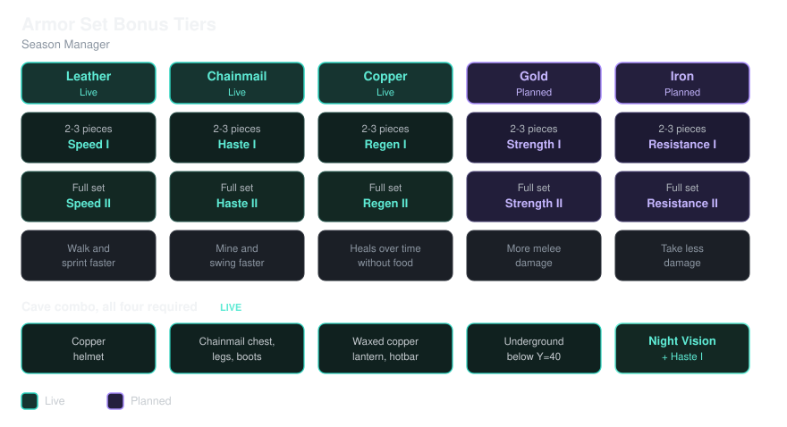

# Season Manager — Release Notes

## Season Manager v1.0.61 — Standing Rules

The baseline ruleset for the season. This is what's true right now,
regardless of when each piece was actually added:

- Some items disappear the moment you pick them up — crafted or found —
  and can't be crafted either: Elytra, Dispenser, Dropper, Sticky
  Piston, Piston, Conduit, Hopper, Hopper Minecart, Crafter, Observer,
  Blaze Powder, Enchanting Table, Comparator, Daylight Detector,
  Repeater.
- All Diamond tools, weapons, and armor are uncraftable — mining and
  holding diamonds is fine, and any diamond gear you already have or
  find/loot still works.
- Iron Golems, Piglins, and Piglin Brutes never stick around — they're
  removed the instant they appear.
- Nether and End portals can't be lit.
- If you end up in the Nether or End some other way anyway, you'll get
  sent right back to where you came from.
- Villager trading is off for all 13 professions.
- Fishing up treasure never comes pre-enchanted.

## Season Manager v1.0.69 — The Leather Update

- **Anvils are back.** Usable and craftable again.
- **New recipe: Leather → Rabbit Hide.** Turn 1 Leather into 4 Rabbit
  Hide (the reverse of the existing Rabbit Hide → Leather recipe).
- **Leather armor now comes from Rabbit Hide.** Helmets, chestplates,
  leggings, and boots all craft from Rabbit Hide instead of Leather —
  same amounts as before, just a different material.
- **Leather armor gives you a speed boost.** Wear 2-3 pieces for Speed
  I, or a full 4-piece set for Speed II. This is a trial — the goal is
  to give Leather more of a reason to exist. If we like how it plays
  out, we may consider similar full-set bonuses for other armor types
  down the line.

## Season Manager v1.0.99 — The Chainmail Update

- **Chainmail armor is craftable.** Vanilla never gave it a real
  crafting-table recipe — now each piece takes Chain plus Nuggets, in
  the same shapes as Iron armor.
- **Chainmail armor gives a mining boost**, mirroring Leather's Speed
  trial: wear 2-3 pieces for Haste I, or a full 4-piece set for Haste II.
- **Armor Trim Templates are much cheaper to duplicate** — 1 Copper
  Ingot instead of 7 Diamonds plus the trim's base material.
- **Turtles can drop Turtle Scute on death** (a small chance, not
  guaranteed), on top of their usual Seagrass.
- **New recipe: Melon Block → 9 Melon Slices**, the reverse of the
  existing Melon Slices → Melon Block recipe.
- **Fishing treasure is a little more generous again** — Bow and
  Fishing Rod catches can come pre-enchanted, same as vanilla; Book
  catches still never do.
- **Redstone Repeater joins the disappear-on-pickup list** alongside
  the other banned redstone components.
- **Wandering Traders now sell light sources** — torches, candles,
  lanterns, Copper Lanterns, Froglights, and End Rods, priced in
  Emeralds by rarity, with a different random selection offered each
  time you meet one. They'll also always trade 1 Diamond for 4
  Emeralds.
- **Major overhaul to the Elite Zombie mini-boss challenge.** He hits
  harder, he's tougher to put down, and he doesn't come alone anymore —
  expect a much rougher fight than before. Details are best discovered
  in person.

## Season Manager v1.0.108 — The Livestock Update

- **Farm animal population cap.** Bedrock has a hard 200-mob world
  limit — once hit, ALL natural spawning stops everywhere, friendly and
  hostile. Pigs, Chickens, Sheep, and Cows now have a combined cap of
  160 world-wide; go over and the surplus despawns. You'll get a chat
  message whenever it happens, so it's never a mystery why animals went
  missing.
- **Fixed: Leather's Speed boost and Chainmail's Haste boost could drop
  out early during bad server lag** (e.g. a busy mob farm bogging things
  down). Both now have a much wider safety margin so a lag spike can't
  cause them to lapse before they're refreshed.
- **Named animals are safe.** Give any Pig, Chicken, Cow, or Sheep a
  Name Tag and it's permanently protected from the population cap
  above — it still counts toward the 160 total, but it will never be
  the one despawned.

## Season Manager v1.0.113 — The Copper Update

- **Copper armor is a healer.** Wear 2-3 pieces for Regeneration I, or
  a full 4-piece set for Regeneration II — same tiering as Leather's
  Speed and Chainmail's Haste. Copper's defense is weak on its own, so
  this is meant to be its real value.
- **New cave combo: Copper Helmet + full Chainmail body (Chestplate,
  Leggings, Boots) + a waxed Copper Lantern somewhere in your hotbar +
  being below Y=40 grants Night Vision**, on top of the Haste I the 3
  Chainmail pieces already give you. Climb back up, swap armor, or drop
  the lantern and it fades out on its own rather than cutting off.
- **Wandering Traders now also sell Mob Heads** — Skeleton Skull,
  Zombie Head, Creeper Head, or a rarer Player Head. Each trader offers
  exactly one, and it only sells once.

## Season Manager v1.0.127 — The Wanderer's Update

- **Wandering Traders now sell Banner Patterns and Pottery Sherds.**
  Every trader carries exactly one random banner pattern (all 10
  patterns, 8-16 Emeralds, sold once) and one random pottery sherd (all
  23 sherds, 1 Emerald each, up to 4 — enough to decorate a whole pot).
- **Minecarts are much faster.** Minecarts and Chest Minecarts now top
  out at 20 blocks per second instead of 8, faster than the best horse.
  Powered rails are still what get them up to speed, so a well-powered
  line is what earns the full 20. **Watch the bends:** at full speed a
  cart can fly off a curve, so slow down before turns (a few unpowered
  Powered Rails make a good brake) until that's smoothed out.
- **The Elite Zombie fight got tougher, and louder.** The boss and its
  guards have more health, and reinforcements now scale with everyone
  in the fight, solo players included — 2 more guards per player each
  wave. Every wave announces itself in chat, so you'll always know when
  more are coming and when the last one has landed.
- **Farm animal cap messages now say what was removed** — one line per
  animal type, like "3 pigs despawned (mob cap)." instead of a single
  total.

## Season Manager v1.0.142 — The Jukebox Update

- **Wandering Traders now sell Music Discs.** One random disc per
  trader (all 22, including the newest ones), priced by rarity, sold
  once.
- Better logging of login/logout times, and recording of specific types of griefing events.

## Season Manager v2.0.36 — The New Haven Update

- **New Haven's Rose Gold gear**, a tier between Iron and Diamond:
  Rose Gold Ingot (1 Gold + 1 Copper), a full armor set, Sword, Axe,
  Pickaxe, Shovel, Hoe, and a Block of Rose Gold (craftable both ways,
  9 Ingots ↔ 1 Block).
- **New Haven's Bubblepearl**, a glowing, animated pastel block line:
  Block, Stairs, Slab, Lantern (stands or hangs from a ceiling), Glass,
  and Pillar. Crafted from any Froglight color + Quartz.
- **Wandering Traders now also sell Bubblepearl and Bubblepearl
  Lantern**, in the same rotating light-source selection as Froglights
  and the vanilla Lanterns.
- **Rose Gold armor grants Strength, and Iron armor now grants
  Resistance** — same tiering as Leather/Chainmail/Copper: 2-3 pieces
  for tier I, a full set for tier II.
- **Repair Rose Gold gear with Rose Gold Ingots** (or raw Gold/Copper
  Ingots at half the effect).

## Season Manager v2.0.49 — The Unclaimed Trial

- **New storyline: The Unclaimed Trial.** The village cartographer,
  impressed by New Haven's progress even before Breaking Bread is
  finished, starts selling a map to a sealed, unexplored Trial Chamber
  — a bet on who the settlement is becoming, not a reward for who
  it's already proven to be. Find and clear it together as a group,
  open every vault (ominous included), and record the win in the Hall
  of Heroes to unlock hopper-based automation.
- **The cartographer sells the Trial Chambers Explorer Map** (12
  Emeralds + 1 Compass) to support it — the first cartographer trade
  turned back on since trading was disabled season-wide.
- **Rose Gold damage values corrected to Bedrock's real numbers.**
  They'd been carried over from the source mod's Java-based math,
  which doesn't match Bedrock's own (different) damage scale. Sword,
  Axe, Pickaxe, Shovel, and Hoe are now all set to Bedrock's real
  Iron-tier damage — strictly below Diamond, matching every other
  Rose Gold stat.
- **Fishing: Book catches can come pre-enchanted again**, same as Bow
  and Fishing Rod catches already were. With all three restored, the
  fishing loot table matches vanilla exactly, so the override file was
  removed outright.

## Season Manager v2.0.44 — The Durability Fix

- **Fixed: Rose Gold tools weren't losing durability while mining.**
  Bedrock never depletes a custom tool's durability from breaking
  blocks on its own — only from hitting something in combat — so the
  Pickaxe, Shovel, Axe, Hoe, and Sword were only taking damage as
  weapons. They now wear down per block broken, at the same rate (and
  with the same Unbreaking behavior) as any vanilla tool — the Sword
  costs double, same as a vanilla sword used to mine instead of the
  correct tool.
